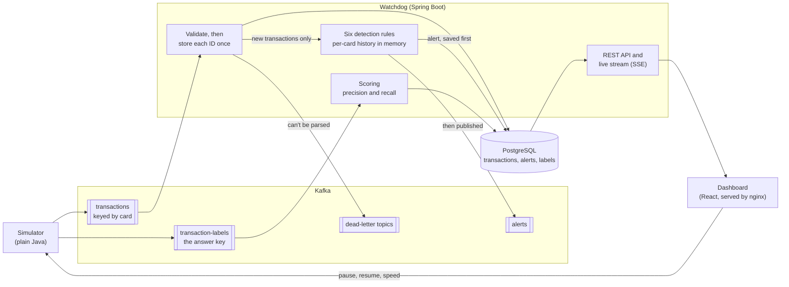

# Budget.io Watchdog

Watchdog watches card transactions as they happen and flags two kinds of problems:

- **Money leaks:** duplicate charges, free trials that turned into paid plans, subscription price hikes, and spending spikes.
- **Suspicious charges:** card testing (several tiny charges, then a big one) and charges from a country the card has never been used in.

It's the next version of Budget.io, a manual budget planner I built earlier. Budget.io asks you to type in what you spent. Watchdog reads the transactions themselves and tells you what looks wrong, with a sentence explaining why, like "Whole Foods Market charged $140.84 twice, 24 seconds apart."

There's no real bank data here. A simulator plays a few people with different spending habits, plants problems on purpose, and publishes an answer key on a separate topic, so the rules can be graded with precision and recall.

## Architecture



- **Simulator** (plain Java): plays a student, a family, and a frequent traveler on a clock that runs a simulated month per real minute. It plants realistic problems, plus legitimate purchases that only look like problems (a second coffee for a friend), and publishes the truth about every transaction to a separate topic. The same seed always produces the same run.
- **Kafka:** holds every transaction, in order per card, until the watchdog reads it. If the watchdog goes down, messages wait, and it picks up where it left off.
- **Watchdog** (Spring Boot): validates each message, stores it once even if Kafka delivers it twice, and sends anything it can't parse to a dead-letter topic. Each new transaction goes through six rules. A hit becomes an alert with a plain-English explanation, saved in the same database transaction as the charge and then published to an `alerts` topic. After a restart it replays the last 90 simulated days from Postgres, so the rules remember each card before it reads anything new.
- **PostgreSQL:** transactions, alerts, and the answer key. Only the scoring code reads the answer key; a test fails the build if detection code mentions it.
- **Dashboard** (React, TypeScript, Vite): Overview, Live feed, Alerts, Analytics, and Recurring, plus controls to pause, resume, and speed up the simulator.

| Part | Built with |
|---|---|
| Simulator | Java 21, Kafka's producer client |
| Messaging | Apache Kafka 4.2 (KRaft, one node) |
| Watchdog | Spring Boot 4.1, Spring Kafka, `JdbcClient` with plain SQL, Flyway |
| Storage | PostgreSQL 18 |
| Dashboard | React 19, TypeScript 7, Vite 8, hand-written CSS and SVG charts, nginx |
| Tests | JUnit, AssertJ, Testcontainers (real Kafka and Postgres), REST Assured, Vitest, Selenium |
| Running it | Docker Compose; Kubernetes manifests for a local kind cluster |

The design, the tradeoffs behind each choice, every rule's thresholds, and the decision log are in [docs/DESIGN.md](docs/DESIGN.md).

## Running it

You only need Docker.

```
docker compose up -d --build     # Kafka, Postgres, the simulator, the watchdog, and the dashboard
docker compose ps                # everything should be "Up"; kafka-init exits after creating the topics
docker compose down              # stop everything and throw the demo data away
```

Then open **http://localhost:8083**. The first build downloads images and dependencies and takes a few minutes; after that, startup takes about 30 seconds.

- Transactions appear within a few seconds. Alerts start about a minute in: the simulator plants nothing during its first 30 simulated days, because several rules need history first.
- The demo pauses itself after 365 simulated days (about 12 real minutes). Press **Resume** in the header to run another 365.
- Kafka and Postgres keep the demo's data in memory, so `down` then `up` is a clean, repeatable run: seed 42 always produces the same transactions.
- Add `--profile tools` to also get Kafka UI at http://localhost:8081.

### A demo you can repeat

About five minutes, start to finish.

1. **Start it:** `docker compose up -d --build`, open http://localhost:8083. The header says "Simulator running" and "Live".
2. **Overview:** the transaction total climbs. Throughput (about 4 to 5 per second at this speed) and latency are measured on the real clock. Everything else on screen is simulated time.
3. **Live feed:** rows arrive on their own. After about a minute, some carry a badge naming the rule that flagged them.
4. **Alerts:** pick "Duplicate charge" in the filter and read the explanations. Each one is written by the rule that fired.
5. **Pause and speed:** press **Pause** and the total holds still. Choose "365 days/min", press **Resume**, and a simulated year goes by in a minute.
6. **Recurring:** each user's subscriptions and bills. Look for "Price up" with both prices, and the free trials that turned into paid plans.
7. **Analytics:** activity per simulated day, a month of spending in Budget.io's categories, and each rule's precision and recall with the counts behind them.
8. **Take the watchdog away:** `docker compose stop watchdog`. The badge turns to "Disconnected, retrying" while the simulator keeps publishing into Kafka. `docker compose start watchdog`: it replays recent history, reads everything that waited, and the totals catch up. Nothing is lost and nothing is stored twice.
9. **Restart the simulator:** `docker compose restart simulator`. It finds where the run stopped and continues from there. Its log says `Continuing an earlier run from ...`.

### Looking underneath

```
docker compose logs -f watchdog | grep "Rule hit"        # each alert as it's raised
curl localhost:8082/actuator/health/readiness             # UP once the warm-up is done
curl localhost:8082/api/stats                             # totals, per-rule scores, throughput, latency
curl "localhost:8082/api/alerts?userId=user-0001&limit=5"
curl "localhost:8082/api/recurring?userId=user-0002"
curl "localhost:8082/api/spending/summary?userId=user-0002&month=2026-03"
curl -N localhost:8082/api/stream                         # live events; Ctrl+C to stop
curl localhost:8083/api/simulator/status                  # the simulator's clock, through nginx
docker compose exec postgres psql -U watchdog -d watchdog \
  -c "select detector, explanation from alerts order by occurred_at desc limit 10"
```

A bad parameter gets a 400 that says what was wrong. The demo's users are `user-0001` to `user-0003`. Every endpoint is described in [docs/DESIGN.md](docs/DESIGN.md).

## Tests

```
./mvnw verify                          # backend: unit tests, then integration tests (needs Docker running)
./mvnw test                            # backend unit tests only, no Docker
cd dashboard && nvm use && npm ci && npm test && npm run build     # dashboard: Node 24 from .nvmrc
./mvnw -Pe2e -pl e2e-tests verify      # browser tests; start the stack first and give it two minutes
```

| Suite | Tests | What it runs against |
|---|---|---|
| Backend unit (`*Test`) | 245 | nothing: plain Java |
| Backend integration (`*IT`) | 39 | real Kafka and Postgres in Docker (Testcontainers) |
| Dashboard unit (Vitest) | 36 | plain TypeScript logic |
| Browser (Selenium, headless Chrome) | 8 | the running Compose stack, through nginx |

All passing on 2026-11-11. What the tests cover, by the question they answer:

- **Does a redelivered message get processed twice?** No: the insert reports it as already stored and the rules never see it. A real duplicated charge (a new ID, the same merchant and amount) is still caught.
- **What if saving or publishing an alert fails halfway?** The transaction and its alerts roll back together and the retry saves them once. An alert that was saved but not published is published when the message comes back.
- **What happens to a message that can't be parsed?** It goes to its topic's dead-letter topic at once and the partition keeps moving.
- **Does a restarted watchdog forget everything?** No: it replays 90 simulated days from Postgres before reading Kafka.
- **Does a restarted simulator flood the system with repeats?** No: it continues where the topic ends. An integration test restarts it against a real Kafka and checks the topic holds every transaction of an uninterrupted run, with only a few repeats at the boundary.
- **Is each rule right?** Every rule is tested for firing, not firing, its window's edges, its look-alikes, and staying separate per card.
- **Does the dashboard show what the backend has?** The browser tests check live rows arriving, the alert filter, pause holding the totals still, and no sideways scrolling on a phone.

`.github/workflows/ci.yml` runs the backend suite, the dashboard suite, and the browser tests on every push. It hasn't run on GitHub yet.

## What's been measured

Everything here was measured on one laptop (a 16 GB Mac, Docker Desktop with 7.65 GiB) with the 3-user demo. None of it is a benchmark of maximum load; that's still to do.

**Reliability**

| Check | Result | When |
|---|---|---|
| Watchdog stopped for 20 s while the simulator published | 85 transactions waited in Kafka; all 85 were stored after the restart, none twice. Ready 13 s after `start` | 2026-11-11, Compose |
| Simulator restarted mid-run | it continued from the topic's end: 443 planned transactions not re-sent, 3 repeats at the boundary, all 3 skipped | 2026-11-11, Compose |
| Kubernetes: simulator pod deleted, watchdog pod deleted, then a rolling restart | `scripts/k8s-check-no-loss.sh` passed: 621 transaction IDs and 16 alert IDs on the topics matched Postgres exactly, 3 repeated messages stored once, both dead-letter topics empty, consumer lag 0 | 2026-11-11, kind |
| Kubernetes: time for a replacement watchdog pod to be Ready | 6.6 s after the delete | 2026-10-30, kind |

The no-loss check compares the actual sets of IDs on the Kafka topics with the rows in Postgres, because equal counts can hide one missing and one extra.

**Speed (demo load, real clock)**

| Simulator speed | Stored per second | Latency, publish to stored |
|---|---|---|
| 30 simulated days per minute (the default) | 4 to 5 | median 12 to 13 ms, p95 about 23 ms |
| 365 simulated days per minute | 31 to 37 | median 8.5 ms, p95 17 ms, p99 28 ms (3,755 transactions) |

Measured 2026-11-11. The numbers show the pipeline keeping up with what the simulator sends, not how much it could take. The first seconds after startup are slower (a p99 near one second), because the simulator starts publishing before the watchdog has finished starting.

**Detection quality** is on the dashboard's Overview and Analytics views, per rule, against the answer key. The demo plants problems far more often than real life, so those are demo rates and I'm not quoting them here as results. [docs/DESIGN.md](docs/DESIGN.md) has the numbers, each rule's known false positives, and why.

## Limitations

- **One watchdog process.** The rules keep each card's history in memory. A restart, a redelivered message, and a rebalance between threads are all handled and tested. Scaling out to several pods isn't: when a card's partition moves to another pod, that pod knows less about the card (11 transactions in a measured rolling update), so alerts around the handover can differ. No transaction or alert is lost.
- **The warm-up covers 90 simulated days.** A restarted watchdog forgets a country a card last used before that.
- **A restarted simulator needs its old messages.** It finds its place from the Kafka topic. Once Kafka has deleted those messages (7 days by default) it starts from the first day, and the watchdog skips what it already has until the replay catches up. The dashboard says so while that happens.
- **The data is simulated.** The rates of each problem are ones I chose, labels are perfect and instant, and nobody is trying to evade the rules. Precision and recall here show the method, not real-world performance.
- **No authentication.** Every port is bound to 127.0.0.1.
- **One Kafka broker, data in memory.** A demo, not a durable deployment.
- **No load benchmark yet**, and CI hasn't run on GitHub yet.
- **Rule limits** (a second price hike in a row isn't alerted, spending-spike assumes roughly normal daily totals, and others) are listed in [docs/DESIGN.md](docs/DESIGN.md).

## What's next

- A benchmark with about 1,000 simulated users: maximum throughput, latency under steady load, and precision and recall over a simulated year with realistic rates.
- Comparing the rules with a model trained on the labeled data (gradient boosting, isolation forest).
- Rule memory that follows a partition between pods, or Kafka Streams state stores.
- Dashboard: filter every view to one user, and trigger a scenario on demand.
- Real transactions through a Plaid adapter, and Budget.io reading real spending from Watchdog.

## The design in two minutes

- **Why Kafka between the simulator and the watchdog?** So the source never waits for detection and nothing is lost when the watchdog is down. Messages are keyed by card, so one card's transactions always land on the same partition and stay in order, which the rules depend on.
- **At-least-once delivery, made safe by idempotent writes.** Kafka may deliver a message twice, so the watchdog commits its offset only after the database commit, and the insert is `ON CONFLICT DO NOTHING` on the transaction ID. A repeat is detected and skipped before the rules see it, so a redelivered message can never look like a duplicated charge.
- **Saving and publishing an alert can't be one step.** The alert row is committed with its transaction and marked published only after Kafka confirms. If the app dies in between, the redelivered message publishes what's still unmarked. It's a light version of the transactional outbox: nothing is lost, an alert can rarely be published twice with the same ID, and readers drop repeats by ID.
- **Bad data doesn't block good data.** A message that can't be parsed goes to a dead-letter topic right away. A database or Kafka outage is retried with backoff, forever, because skipping a valid message would lose it and break the card's order.
- **Event time, not wall-clock time.** Rules only use when a transaction happened. The real clock is used for exactly one thing, measuring latency.
- **State in memory, rebuilt from the database.** Each rule keeps a small per-card history. It's fast and easy to unit test, and the cost is the scale-out limit above.
- **Honest metrics.** The simulator plants look-alikes so the rules can't score perfectly, the rules can't read the answer key, and throughput counts only new rows. When the consumer is busy skipping repeats, the dashboard says that instead of showing a puzzling zero.
- **A bug this design caught, and one it hid.** Restarting only the simulator made it publish its whole deterministic run again. Idempotent ingest correctly dropped all 9,736 messages, and the dashboard showed a running simulator with zero throughput. The fix was on the source (continue from the end of its own topic) plus a count of skipped repeats so the next surprise is visible.

## Running it on Kubernetes (kind)

The same stack on a local, single-node Kubernetes cluster. It's a practice cluster on one laptop, not production. You need Docker; the scripts download their own pinned kind and kubectl. The dashboard isn't deployed there, so this is the backend only.

```
scripts/install-tools.sh        # once: kind v0.33.0 and kubectl v1.37.1 into .tools/bin, checksums checked
scripts/k8s-up.sh               # cluster, images, Kafka, Postgres, the simulator, the watchdog; waits until all Ready
scripts/k8s-up.sh --with-ui     # the same, plus Kafka UI
scripts/k8s-down.sh             # delete the cluster and everything in it
```

- Use the pinned kubectl with the cluster's context: `.tools/bin/kubectl --context kind-watchdog -n watchdog get pods`.
- The API: `.tools/bin/kubectl --context kind-watchdog -n watchdog port-forward svc/watchdog 8082:8082`, then the same `curl` commands as above.
- Things to try: delete the watchdog pod and watch a new one warm up and take over (`kubectl delete pod -l app=watchdog`), scale it (`kubectl scale deployment watchdog --replicas=3`), or roll it (`kubectl rollout restart deployment/watchdog`). Then scale the simulator to 0 and run `scripts/k8s-check-no-loss.sh`.
- With several watchdog pods, the rules' memory of a card stays in the pod that had it, and each pod's live stream only shows its own partitions. Both are written up in [docs/DESIGN.md](docs/DESIGN.md) with the measured results.

## Development

You need Java 21, plus Docker for the full stack. `./mvnw` downloads the right Maven version on first use and checks its checksum. The dashboard uses Node 24, pinned in `dashboard/.nvmrc`; with [nvm](https://github.com/nvm-sh/nvm), `nvm install && nvm use` inside `dashboard/`.

```
./mvnw -pl simulator -am test    # one module, plus the modules it depends on
cd dashboard && npm run dev      # http://localhost:5174, with /api passed to the watchdog on localhost:8082
docker compose up -d --build --no-deps dashboard    # rebuild only the dashboard's container
```

- To run the watchdog from an IDE, start the stack, `docker compose stop watchdog`, and run `WatchdogApplication`. Its defaults point at Kafka on `localhost:9094` and Postgres on `localhost:5432`.
- The dev server only forwards `/api` to the watchdog, so the simulator controls say "unavailable" there. They work through nginx on port 8083.

### Project layout

```
transaction-schema/   message formats shared by every program: records, JSON Schemas, topic names
simulator/            the plain Java transaction generator and its control API
watchdog-service/     the Spring Boot service: Kafka in, PostgreSQL out, detection rules, alerts, the REST API
dashboard/            the React dashboard, served by nginx in Compose
e2e-tests/            browser tests (Selenium), built only with -Pe2e
config/               simulator presets
k8s/                  Kubernetes manifests for the kind cluster
scripts/              kind setup, up, down, and the no-loss check
docs/DESIGN.md        design, tradeoffs, and the decision log
```

### Conventions

- Money is whole cents in a `long`, never a `double`.
- The simulator and the rules only use event time (`occurredAt`). The real clock is only for measuring latency.
- Kafka messages are keyed by `cardId`, so each card's transactions stay in order.
- Every database write is safe to repeat. Anything reading the `alerts` topic should drop duplicates by `alertId`.
- Messages are read and written through `MessageJson`, which is stricter than Jackson's defaults.
- Database access is plain SQL with `JdbcClient`, no JPA. Schema changes go in a new Flyway migration; a committed one never changes.
- The simulator stays deterministic: the same seed gives the same data, whatever the pause and speed controls do.
- Each detection rule is one class with its thresholds in `application.yml` under `watchdog.rules`.
- Unit tests end in `Test`. Integration tests end in `IT` and need Docker.

### Gotchas

- Restarting just the Postgres container wipes the demo data (it's in memory). Restart the whole stack, or run `SIM_RESUME=false docker compose up -d simulator` so the simulator publishes the run again and refills it.
- A restarted watchdog replays the last 90 simulated days from Postgres before it reads Kafka, so `/actuator/health/readiness` says `OUT_OF_SERVICE` for a moment.
- Kafka has two addresses: `kafka:9092` inside Docker and `localhost:9094` from your machine.
- Throughput and latency only mean something while the machine stays awake. When the laptop sleeps, Docker pauses with it.
- Maven's version is pinned in two places, `.mvn/wrapper/maven-wrapper.properties` and the build image in both Dockerfiles. Change them together.

## How I built this

I used Claude Code as a development and learning tool while building Watchdog, particularly to help me understand Java, Spring Boot, Kafka, and the technical decisions behind the implementation.
