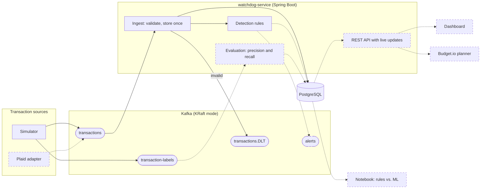

# Budget.io Watchdog: Design

Watchdog watches card transactions as they happen and flags two kinds of problems:

- **Money leaks:** duplicate charges, free trials that quietly turned into paid plans, subscription price hikes, and spending spikes.
- **Suspicious charges:** card testing (several tiny charges, then a big one) and charges from a country the card has never been used in.

It's the next version of Budget.io, my manual budget planner. This doc covers how Watchdog works, why I built it this way, and where it's going.

**Status:** Phases 1 and 2 are built and tested: the transaction pipeline, and six detection rules that check every new transaction. For now the rules log each hit with a plain-English explanation; alerts and metrics come in Phase 3. Everything after Phase 2 is planned and marked that way below.

## Roadmap

| Phase | What | Status |
|---|---|---|
| 1 | Transaction pipeline: a simulator, Kafka, and a Spring Boot service that validates transactions and stores them in PostgreSQL | Done |
| 2 | Six detection rules, with unit tests (hits are logged until Phase 3) | Done |
| 3 | Alerts, detection metrics (precision and recall), a REST API, integration and API tests | Planned |
| 4 | Dashboard, with a Selenium end-to-end test | Planned |
| 5 | CI with GitHub Actions, and benchmark results in the README | Planned |
| 6 | Data science: compare the rules with an ML model | Planned |

I'd like to finish the dashboard and CI before Phase 6, but Phase 6 only needs the simulator, the labels, and the rules' alerts, so I could also pick it up right after Phase 3.

## Background: Budget.io

Budget.io is a budget planner I built with React, TypeScript, and Vite. You type in your income, expenses, and debts, the data stays in your browser's localStorage, and an OpenAI-backed assistant gives budgeting advice. There's no transaction data: the closest thing is spending you enter by hand.

Its categories are free text. The defaults are Rent/Mortgage, Utilities, Food, and Transportation, and the budget breakdown adds a TP Fund ($100 or $200 of fun money), one line per debt, Savings, and an Emergency Fund.

### How Watchdog connects to it

Watchdog has a fixed list of categories. It's more detailed than Budget.io's because the rules need to tell dining apart from groceries, but every category rolls up into exactly one Budget.io line:

| Watchdog `Category` | Budget.io line |
|---|---|
| `INCOME` | the income field |
| `RENT` | Rent/Mortgage |
| `UTILITIES` | Utilities |
| `GROCERIES`, `DINING` | Food |
| `TRANSPORTATION` | Transportation |
| `SHOPPING` | TP Fund |
| `SUBSCRIPTIONS` | Subscriptions (a custom line) |
| `TRAVEL` | Travel (a custom line) |

Budget.io already supports custom expense lines, so the two new ones need no changes there. The plan (Phase 3) is an endpoint, `GET /api/spending/summary?userId=…&month=YYYY-MM`, that returns income and spending grouped by Budget.io line, so the planner could eventually fill itself in instead of relying on manual entry.

Two other differences from Budget.io:

- Money is stored as whole cents in a `long` (`amountCents`). Floats can't represent amounts like $0.10 exactly, so totals drift, and a `long` holds far more cents than I'll ever need.
- Budget.io has one implicit user per browser. Watchdog adds a `userId` and a `cardId` to every transaction.

## Architecture



Solid boxes and arrows exist today. Dashed ones are planned.

1. A source publishes each transaction to the `transactions` topic in Kafka, keyed by card. Right now the only source is the simulator, which also publishes a ground-truth label for every transaction to `transaction-labels`.
2. The watchdog reads `transactions`, validates each message, and stores it once in PostgreSQL. Messages it can't parse go to `transactions.DLT`.
3. The detection rules check each new transaction and log every hit with a plain-English explanation. Planned (Phase 3): each hit becomes an alert that's saved to Postgres and published to `alerts`.
4. Planned: an evaluation step compares the alerts with the labels to measure precision and recall. The rules never see the labels.
5. Planned: a REST API with live updates feeds the dashboard, and later the Budget.io planner.

**Why Kafka sits in the middle.** The simulator never talks to the watchdog or the database directly. Kafka holds every message until the watchdog reads it, so the watchdog can go down, come back, and pick up where it left off. Stopping the watchdog for 20 seconds while the simulator kept running shows this: 130 transactions piled up in Kafka, and within seconds of the restart they were all stored, none lost. It also means other programs can read the same stream later without the simulator knowing about them. The tradeoff is that Kafka is one more system to run and understand.

## Phase 1: what's built

### The transaction message

Every source publishes this JSON to `transactions`, keyed by `cardId`:

```json
{
  "schemaVersion": 1,
  "transactionId": "5278a1ec-0766-3f2e-ba13-845077395928",
  "source": "SIMULATOR",
  "userId": "user-0001",
  "cardId": "card-0001",
  "merchant": "Blue Bottle Coffee",
  "category": "DINING",
  "amountCents": 545,
  "currency": "USD",
  "country": "US",
  "occurredAt": "2026-01-01T09:45:10Z",
  "publishedAt": "2026-10-27T23:40:46.732514085Z"
}
```

| Field | Type | Meaning |
|---|---|---|
| `schemaVersion` | int | Always 1 for this version. |
| `transactionId` | UUID | Unique per transaction. It's the idempotency key. |
| `source` | string | `SIMULATOR` today, `PLAID` later. |
| `userId` | string | Who owns the card. |
| `cardId` | string | The card (or account) the transaction posted to. Also the Kafka key. |
| `merchant` | string | Merchant name. |
| `category` | enum | One of the categories above. |
| `amountCents` | long, never negative | Money out, except `INCOME`, which is money in. |
| `currency` | ISO 4217 code | `USD` only for now. |
| `country` | ISO 3166-1 alpha-2 code | The merchant's country. |
| `occurredAt` | ISO-8601 instant | When the purchase happened (event time). For simulated data, this is the simulator's clock. |
| `publishedAt` | ISO-8601 instant | Real time when the source published it. End-to-end latency starts here. |

The decisions behind it:

- **Keyed by card.** Kafka only keeps messages in order within a partition, and messages with the same key always land in the same partition. Keying by card keeps each card's transactions in order, which the rules will depend on.
- **Two timestamps.** Rules will use `occurredAt` only, so they give the same answer however fast the simulator runs. Latency uses `publishedAt` and the real clock.
- **One contract, enforced.** The `Transaction` record in `transaction-schema` is shared by every Java producer and consumer, and its constructor rejects invalid values, so an invalid transaction can't exist in the code. All JSON reading and writing goes through one shared `MessageJson` configuration that's stricter than Jackson's defaults, because by default Jackson turns `15.49` into `15` and accepts `"1549"` as a number. A JSON Schema file (`transaction.v1.schema.json`) describes the same contract for sources written in other languages, and contract tests check that the record and the schema accept and reject the same messages.
- **JSON, not Avro.** JSON is readable in Kafka UI and in logs, and there's no Schema Registry to run. Avro or Protobuf with a registry would be the upgrade if the schema starts changing a lot.
- **Changing it later.** Consumers ignore fields they don't know, so a producer can add a field without breaking anyone. A breaking change would bump `schemaVersion`, and a consumer sends versions it doesn't understand to the DLT.

### Ground-truth labels

The simulator makes up every transaction, so it already knows which ones are problems. It publishes one label per transaction to `transaction-labels`, keyed by `transactionId`:

```json
{
  "schemaVersion": 1,
  "transactionId": "5278a1ec-0766-3f2e-ba13-845077395928",
  "persona": "STUDENT",
  "issueType": "NONE",
  "scenarioId": null,
  "edgeCase": null
}
```

- `issueType` is `NONE` for normal transactions, including legitimate ones that just look suspicious.
- It describes the transaction itself. In a duplicated charge, the original is `NONE` and the copy is `DUPLICATE_CHARGE`. For a free trial, the $0 or $1 signup is `NONE` and the first full charge is `TRIAL_CONVERSION`. On a binge day, every purchase in that category is `SPENDING_SPIKE`, because the spike is about the day's total. In card testing, the tiny probes and the big charge are all `CARD_TESTING`.
- `scenarioId` groups the transactions that belong to one injected issue or look-alike, like a duplicated pair, a trial and its conversion, or a whole trip. It's `null` for ordinary transactions.
- `edgeCase` names the legitimate look-alike a transaction belongs to, for error analysis.
- `persona` is there for analysis. It's never an input to detection.

Labels get their own topic on purpose. It's like keeping an exam's answer key in a separate folder from the questions: if the answers traveled with the transactions, detection could see them and the scores would mean nothing (in data science this is called label leakage). Real transactions, from Plaid for example, won't come with labels at all, so detection can't depend on them. Only the evaluation code will ever read this topic.

### The simulator

The simulator is a plain Java program, no Spring, that pretends to be a group of people spending money.

**A simulated clock.** Simulated time = start date + real time elapsed × speed. The demo runs one simulated month per real minute, so a day takes about 2 seconds, and free trials and subscription cycles that take weeks play out in under a minute. Setting `SIM_DAYS_PER_MINUTE=max` drops the waiting, which is what benchmarks and dataset generation need.

**Repeatable runs.** For each simulated day, every user's spending behaviors plan that day's transactions. The day is sorted by time, and each transaction is published when the clock reaches it. Simulated people live in UTC, which keeps time zones out of the picture. All randomness comes from one seed: a root generator hands each user their own stream with `SplittableRandom.split()`, in user order, so adding users never changes existing users' histories. Transaction IDs are name-based UUIDs built from the seed, the user, and a counter. The same settings always produce the same transactions, labels, and IDs, which makes results reproducible and makes a simulator restart harmless, because the watchdog skips IDs it already has.

#### Personas

Each user has one card, a home country of US, and a persona that sets their income, bills, habits, and how often they start free trials or travel:

| Persona | What it looks like |
|---|---|
| `STUDENT` | small biweekly paychecks, shared rent, coffee most mornings, lots of dining and delivery, 6 subscriptions, about one free trial a month, travels the least |
| `YOUNG_PROFESSIONAL` | a salary, rent, dining out, rideshare, 5 subscriptions, average travel |
| `FAMILY` | two paychecks, a mortgage, big grocery runs, higher utility bills, a car, the most shopping |
| `FREQUENT_TRAVELER` | a high salary, lots of dining out, rideshare, trips about five times as often as average |
| `RETIREE` | one monthly payment, steady bills, lower spending, a car, 3 subscriptions, rarely tries free trials |

The exact numbers are in `Persona.java`. Personas are assigned in exact proportion (`SIM_PERSONA_MIX`) with weighted round-robin, not by random draw, so 1,000 users at 25% students means exactly 250 students. The live demo runs 3 users (a student, a family, and a frequent traveler). The benchmark and the Phase 6 dataset will use about 1,000.

**Everyday spending:** biweekly or monthly paychecks, rent or mortgage on the 1st, monthly utilities (electricity and water vary, internet and phone don't), groceries, dining, coffee, gas or rideshare, shopping, 3 to 6 subscriptions depending on the persona, occasional free trials, and occasional trips. Amounts come from log-normal distributions, because real spending is skewed: lots of small purchases and a few big ones. Times of day follow the activity, like coffee between 7 and 10 am and paychecks at 6 am.

#### Injected issues and look-alikes

| Issue (`issueType`) | How it's injected | Legitimate look-alikes (`edgeCase`) | What a good rule should do |
|---|---|---|---|
| `DUPLICATE_CHARGE` | a card purchase posts again 5 to 90 seconds later | `DOUBLE_COFFEE`: the same coffee at the same price, 1 to 5 minutes apart (buying for a friend) | catch the duplicate; the double coffee is an expected false positive, and the same coffee hours apart must not fire |
| `TRIAL_CONVERSION` | a $0 or $1 trial converts to full price 7 to 30 days later | `CANCELLED_TRIAL` (no conversion); `APP_STORE_PURCHASES`: $0.99, then $9.99 at the same merchant 5 to 20 days later | catch the conversion; the App Store pair is an expected false positive |
| `PRICE_HIKE` | a subscription costs 10 to 25% more at renewal | utility bills that vary every month (ordinary behavior, not labeled) | catch the hike, never fire on utilities |
| `SPENDING_SPIKE` | a binge day: 3 to 5 extra purchases in dining or shopping | `LEGIT_BIG_PURCHASE` (like a laptop); spending during `LEGIT_TRAVEL` | catch the binge; the look-alikes are expected false positives |
| `CARD_TESTING` | 3 to 5 charges of $0.50 to $2.00 at different merchants, then one of $150 to $900, all within an hour | `TOLL_ROAD_TRIP`: several tolls, then a hotel, within an hour | catch the attack; the road trip is an expected false positive |
| `NEW_COUNTRY` | a charge from a country the card has never been used in | `LEGIT_TRAVEL`: a flight booked at home, then charges abroad; `FOREIGN_ONLINE_ORDER`: one order from a foreign shop with no trip | catch the fraud; stay quiet when a trip was booked first; the online order is an expected false positive |

The look-alikes exist so the metrics can't be trivially perfect. No issues or look-alikes are injected during a warm-up period (30 simulated days by default), because several rules need history first. Trips and injected fraud draw countries from the same neutral list, so no country is treated as inherently risky. Fraud uses fictional merchant names, so no real company is shown as a fraudster.

#### Configuration

The simulator reads environment variables, with defaults that work for a local run. `config/simulator.demo.env` is the preset that `docker compose up` uses.

| Variable | Demo value | Meaning |
|---|---|---|
| `SIM_SEED` | `42` | The seed for all randomness. |
| `SIM_USERS` | `3` | How many simulated people. |
| `SIM_PERSONA_MIX` | `STUDENT:1,FAMILY:1,FREQUENT_TRAVELER:1` | Persona weights, assigned in exact proportion. |
| `SIM_START_DATE` | `2026-01-01` | The first simulated day. |
| `SIM_DAYS_PER_MINUTE` | `30` | Simulated days per real minute, or `max`. |
| `SIM_DURATION_DAYS` | `0` | Stop after this many simulated days (0 runs until stopped). |
| `SIM_ISSUES_START_AFTER_DAYS` | `30` | The warm-up before anything is injected. |
| `SIM_RATE_*` | turned up | One rate per issue and look-alike. The unit is per card purchase, per renewal, per morning coffee, a share of free trials, or per user per day, depending on the rate. |
| `KAFKA_BOOTSTRAP_SERVERS` | `kafka:9092` | Where to publish. |

The demo turns the rates up so problems show up every few seconds. A benchmark preset (Phase 5) will keep problems rare, well under 1% of transactions, while still producing a few hundred of each type.

### Ingesting transactions

The watchdog is a Spring Boot app. For each message on `transactions`:

1. A `@KafkaListener` receives it. Three consumer threads share the topic's three partitions, so each card's transactions are handled in order by one thread.
2. It parses the JSON into a `Transaction`. A message that fails goes straight to `transactions.DLT`, with the reason in its headers and a warning in the log, so one bad message can't block a partition.
3. It stores the transaction with `INSERT ... ON CONFLICT (transaction_id) DO NOTHING`. If the row already exists, Kafka delivered the same message twice and the watchdog skips it. A duplicate message must never look like a duplicate charge.
4. A new transaction (not a skipped one) goes through the detection rules, described under Phase 2.
5. Kafka's offset, its bookmark for where the watchdog is in the topic, gets committed after processing.

Saving alerts comes in Phase 3.

**When things go wrong:**

- **At-least-once delivery.** Offsets are committed after processing, so after a crash a message might be delivered again, but it's never lost. That's why every write has to be safe to repeat.
- **Bad data vs. outages.** Invalid messages go to the DLT right away, because retrying won't fix them. Anything else, like Postgres being down, gets retried with growing waits (1 second, doubling up to 30 seconds) without giving up. Skipping would lose a valid transaction and break per-card ordering, so the partition just waits. The catch is that a bug that throws on a valid message would also be retried forever and stall its partition, so the logs need watching.
- **Why not exactly-once?** Kafka transactions would add a lot of machinery. At-least-once delivery plus idempotent writes gives the same visible result here.

### Storage

PostgreSQL 18, with one table so far:

| Table | Columns |
|---|---|
| `transactions` | every message field plus `processed_at` (when the watchdog stored it). Primary key `transaction_id`; indexes on `(card_id, occurred_at)` and `processed_at`. |

Flyway applies numbered SQL migrations at startup. A committed migration never changes; schema changes go in a new file. I went with Spring's `JdbcClient` and plain SQL instead of JPA: every query is visible, the planned stats need SQL features like `percentile_cont`, and there's no object graph for an ORM to help with.

### Running it locally

`docker compose up --build` runs everything:

| Service | Image | What it does | Port on your machine |
|---|---|---|---|
| `kafka` | `apache/kafka:4.2.2` | a single node acting as both broker and KRaft controller | 9094 |
| `kafka-init` | `apache/kafka:4.2.2` | creates the topics, then exits | none |
| `postgres` | `postgres:18.6-alpine` | storage | 5432 |
| `simulator` | built from `simulator/Dockerfile` | the transaction source | none |
| `watchdog` | built from `watchdog-service/Dockerfile` | consumer and storage (the API comes in Phase 3) | none yet |
| `kafka-ui` | `kafbat/kafka-ui:v1.5.0`, profile `tools` | browse topics and messages | 8081 |

| Topic | Partitions | Key |
|---|---|---|
| `transactions` | 3 | `cardId` |
| `transaction-labels` | 3 | `transactionId` |
| `transactions.DLT` | 3 | the original key. It needs at least as many partitions as `transactions`, because a failed message keeps its partition number. |
| `alerts` (Phase 3) | 3 | `cardId` |

A few details:

- **Topics are created explicitly.** Kafka's automatic topic creation is off, so a typo can't silently create a one-partition topic. The `kafka-init` container creates them, and the apps wait for it to finish.
- **Two Kafka listeners.** Containers connect to `kafka:9092`. Programs on your machine, like the watchdog run from an IDE, connect to `localhost:9094`.
- **Local only.** Every port is bound to 127.0.0.1, and the credentials are for local development only.
- **A throwaway demo.** Kafka and Postgres keep their data in memory (tmpfs), so every `docker compose up` starts a fresh, repeatable run. Without that, a restarted simulator would replay transactions the watchdog already has, and the demo would go quiet until it caught up. Kafka runs as a non-root user, so its tmpfs needs `mode=1777`. Restarting just the Postgres container wipes its data.
- **Images.** Each Dockerfile builds in the official `maven:3.9.16-eclipse-temurin-21-noble` image (the same Maven and Java as `./mvnw`) and runs on a smaller `eclipse-temurin:21` Java runtime image as a non-root user. Tests run in CI, not inside image builds.

### Testing (Phase 1)

Phase 1 added 78 unit tests:

- **`transaction-schema` (35):** contract tests that give the `Transaction` record and the JSON Schema the same valid and invalid messages and check that they agree, the label rules, and the Budget.io category mapping.
- **`simulator` (38):** the same seed gives identical data; adding users doesn't change existing ones; every transaction makes a valid message with exactly one label; nothing is injected during the warm-up; scenario counts land within 15% of their configured rates over 300 users and a simulated year; each scenario has the shape the rules will look for; plus the persona assignment and the clock math.
- **`watchdog-service` (5):** parsing, including that bad input becomes an `InvalidTransactionException`.

Manual checks on the running stack:

| Check | Result |
|---|---|
| Transactions reach Postgres | 88 to 126 rows in 10 seconds |
| Messages have the right keys | transactions keyed by card ID, labels by transaction ID |
| A malformed message | lands in `transactions.DLT` with the reason in its headers; the watchdog keeps running and logs a warning |
| The same message sent twice | still one row, logged as "already stored" |
| Simulator restarted | the 79 replayed messages were skipped, no duplicate rows |
| Postgres paused for 30 seconds | the backlog grew to 128 messages, then drained to 0 within 10 seconds, with nothing sent to the DLT |
| Watchdog stopped for 20 seconds | 130 transactions waited in Kafka and were all stored after the restart; the oldest was 30 seconds late |

With the simulator paused, the topic held 1,032 distinct transaction IDs and Postgres held exactly those 1,032 rows. On my laptop, steady-state latency from publish to stored was 9.6 ms at the median and 14.2 ms at the 95th percentile.

Integration tests with real Kafka and Postgres (Testcontainers), API tests, a browser end-to-end test, and CI come in Phases 3 to 5.

### What Phase 1 taught me

A few real bugs and surprises came up while building Phase 1. I'm keeping them here because each one changed the design.

- **Correlated random numbers.** The first version gave each user a seed of `seed ^ (n * 0x9E3779B97F4A7C15)`. That constant turns out to be `SplittableRandom`'s own internal step, so user 65 replayed user 1's numbers shifted by 64 draws, and 300 users behaved like about 64. The rate tests caught it: five scenario counts came out 20 to 25% too high. Switching to `split()` fixed it.
- **Lenient JSON.** By default, Jackson truncates `15.49` to `15` and accepts the string `"1549"` as a number. That's why all message parsing goes through `MessageJson`, and why the contract tests cover both cases.
- **A silent dead-letter topic.** The first malformed-message check worked, but the watchdog logged nothing, so bad data could pile up unnoticed. It now logs a warning with the reason for every message it sends to the DLT.
- **Kafka couldn't write its data.** The first `docker compose up` failed because Kafka runs as a non-root user and the in-memory folder wasn't writable. The fix was `mode=1777` on the tmpfs mount.
- **One checksum, two downloads.** The Maven wrapper downloads a `.zip` when `unzip` is installed and a `.tar.gz` when it isn't, and a pinned checksum can only match one of them. That's why the Docker builds use the official Maven image instead of `./mvnw`, which means Maven's version is pinned in two places.
- **Checking the check.** The first "did every transaction make it to Postgres?" comparison read the topic while the simulator was still writing to it and reported 12 extra rows, which looked like a bug. Pausing the simulator gave a clean comparison, and the counts matched exactly.

## Phase 2: what's built

Six detection rules check every new transaction. Each rule is its own class behind one interface, so adding a rule means adding a class, and a `RuleEngine` runs them all:

```java
public interface DetectionRule {
    String id();                                // "duplicate-charge"; Phase 3 stores it as the detector's name
    IssueType detects();                        // the one issue type this rule is scored against
    Optional<RuleHit> evaluate(Transaction tx); // checks tx against this rule's per-card history, then updates it
}
```

Each rule says which issue type it detects, so Phase 3 can score it against the labels, and an ML model can later be scored the same way. A hit carries the rule's ID, that issue type, and a plain-English explanation with the numbers behind it. Until Phase 3 adds alerts, the listener logs each hit:

```
Rule hit duplicate-charge on card-0002 at 2026-03-08T18:57:45Z (transaction c1ff7a9f-99d1-34a8-a5a0-2b0719ce3f42): Whole Foods Market charged $140.84 twice, 24 seconds apart.
```

### The rules

| Rule | Kind | Fires when | Example explanation |
|---|---|---|---|
| `duplicate-charge` | leak | the same merchant and amount on the same card within 10 minutes | "Whole Foods Market charged $87.42 twice, 40 seconds apart." |
| `trial-conversion` | leak | a charge of $1 or less, then the same merchant charges more than $1 and at least 5 times as much, 5 to 45 days later; once per trial | "Peacock charged $10.99, 12 days after a $0.00 charge. A free trial may have turned into a paid plan." |
| `price-hike` | leak | a merchant's last two charges were 26 to 35 days apart and within 1% of each other, and the next one, 26 to 35 days later, is more than 1% higher | "Netflix charged $17.99, up from $15.49 last month." |
| `spending-spike` | leak | today's dining or shopping total reaches 3 standard deviations above this card's usual day in that category; needs 14 days with spending and at least $50 today; once per category per day | "You've spent $182.40 on dining today. On a usual dining day this card spends about $30.00." |
| `card-testing` | suspicious | 3 or more charges of $2 or less in the 60 minutes before a charge of $100 or more; once per burst | "3 charges of $2.00 or less in the 25 minutes before a $412.50 charge at ElectroMart Online. Someone may be testing your card number." |
| `new-country` | suspicious | a charge from a country the card isn't normally used in, unless there was a travel purchase in the last 30 days; needs 20 earlier transactions; flagged countries aren't learned, so fraud can't teach the rule it's normal | "$812.40 at Luxury Goods Outlet (France), a country this card isn't normally used in, with no travel purchases in the last 30 days." |

"Suspicious charge" is split into two rules so each class does one thing and gets its own precision and recall. Two refinements came from reviewing the rules:

- **Trial conversions and holds.** While reviewing the rule, I realized a gas-pump hold could still trigger a false alert a week later: a $1 hold, the real fill-up minutes later, then next week's fill-up at the same station. Now a charge over $1 from the same merchant within the first 5 days makes the rule forget the small charge, since that was a hold or a purchase, not a trial. On the prototype data (below) it removed 88 false positives without missing any real conversions.
- **Explanations that stay true.** A third identical charge says "charged $5.45 again, 60 seconds after an identical charge", because "twice" would be wrong. New-country doesn't say "first charge from France", because a flagged country isn't learned and fires again on its next charge.

### How every rule works

- **Event time only.** Rules compare `occurredAt` values and never read the clock, so they give the same answer at any simulator speed.
- **Check, then learn.** A rule checks a transaction against what it knew before, then adds it. Learning first would make every charge a duplicate of itself, and a hotel abroad could count as the travel purchase that excuses itself.
- **Only general signals.** Amounts, timing, categories, and the card's own history. No merchant names or country lists, so the rules can't learn the simulator's giveaways (fictional fraud merchants, the fixed list of probe merchants), and they'd work the same on Plaid data.
- **Each new transaction once.** The listener only runs the rules when the insert was new, so a message Kafka delivers twice never reaches them.
- **Income is skipped** by the engine.
- **One broken rule can't hide the others.** The engine catches an exception from a rule, logs it at ERROR, and runs the rest. Rethrowing wouldn't help: Kafka's retry would find the transaction already stored and silently skip every rule.
- **Time order and days.** Each card's transactions are assumed to arrive in time order, which the simulator and the per-card keying guarantee. Days are UTC days, like the simulator's people.

### Where each card's history lives

The rules need history: recent charges, running averages, countries seen. The options I looked at:

| Option | Pros | Cons |
|---|---|---|
| **In memory inside each rule, keyed by card, rebuilt from Postgres at startup (my pick)** | fast, simple, and the rules can be unit tested with no infrastructure | lives in one process; running several watchdogs would mean rebuilding state whenever partitions move |
| Query Postgres for every transaction | always durable, nothing to rebuild | a database round trip per rule per transaction, and rule tests need a database |
| Kafka Streams state stores | the standard streaming answer; durable, and handles partitions moving | a lot of new concepts for this project |
| Redis | shared and fast | another service to run and explain |

Each rule keeps its history in memory, in a map keyed by card. It stays small: time windows are pruned on every transaction, merchants and small charges that can't matter anymore are dropped, and the spending-spike rule keeps three running numbers per category (Welford's algorithm, below). Unit tests feed one card a simulated year of transactions and check that each windowed rule's memory stays bounded.

Each card normally arrives on one consumer thread, but the engine still takes a per-card lock around that card's rules. The lock is almost never contended, because only one thread usually asks for a given card. It's there because Kafka can move a partition to another thread: during testing, two partitions moved at startup, about 3 seconds in. Java only guarantees that the new thread sees the old thread's changes to a card's history if they hand over through a lock. The same lock will cover the Phase 3 warm-up, which replays history on a different thread.

The history isn't rebuilt at startup yet. That warm-up, replaying about 90 simulated days from Postgres through the rules with alerts switched off, is planned for Phase 3, so for now a restarted watchdog starts with empty memory (see Known limitations). Scaling out to several watchdogs would mean moving to Kafka Streams.

### Thresholds

Every threshold lives in `application.yml` under `watchdog.rules.*`, can be overridden with an environment variable (for example `WATCHDOG_RULES_DUPLICATECHARGE_WINDOW=5m`), and is checked at startup: a bad or missing value stops the app with a message that names the setting. They're starting values I'll tune against real metrics in Phase 3. Several came straight from how I built the simulator, so the last column says where each one came from.

| Setting | Value | Why this value | Came from |
|---|---|---|---|
| `duplicate-charge.window` | 10 min | A glitch reposts a charge within seconds to minutes. The simulator's copies land 5 to 90 seconds later, and its double coffees 1 to 5 minutes later, so this window catches both. | both |
| `trial-conversion.max-trial-cents` | $1.00 | Trials sign up for $0 or with a $1 card check. | both |
| `trial-conversion.min-multiple` | 5× | A paid plan costs many times a $1 check. The simulator's plans cost $10.99 to $69.99. | simulator |
| `trial-conversion.min-delay` | 5 days | Sooner than that is a hold followed by the real charge, like at a gas pump, not a trial. | real world |
| `trial-conversion.max-delay` | 45 days | Real trials usually last 7, 14, or 30 days, so the first full charge lands in this range with some margin. The simulator converts at 7 to 30 days. | both |
| `price-hike.min-gap`, `max-gap` | 26 to 35 days | Monthly billing lands 28 to 31 days apart, plus time of day and short months. | real world |
| `price-hike.tolerance-percent` | 1% | Subscriptions repeat the exact price; 1% leaves room for small rounding or tax changes. The simulator's hikes are 10 to 25%. | both |
| `spending-spike.categories` | dining, shopping | The impulse categories; fixed bills can't spike and broke the math (below). Also where the simulator plants binges. | both, disclosed |
| `spending-spike.min-std-devs` | 3 | The usual line for "far from normal". Real spending is skewed, so it fires more often than the normal math predicts. | real world |
| `spending-spike.min-history-days` | 14 | Fewer days with spending give a noisy baseline. | real world |
| `spending-spike.min-day-total-cents` | $50 | A spike under $50 isn't worth an alert, even when it's unusual. | real world |
| `card-testing.max-probe-cents` | $2.00 | Card testers use tiny amounts to avoid notice. The simulator's probes are $0.50 to $2.00. | both |
| `card-testing.min-probes` | 3 | One small charge is normal, like an app or a toll; several in an hour is the pattern. The simulator's attacks use 3 to 5. | both |
| `card-testing.window` | 60 min | Attacks are quick, and the simulator's always fit within an hour. | simulator |
| `card-testing.min-charge-cents` | $100 | The cash-out is a real purchase. The simulator's are $150 to $900. | simulator |
| `new-country.min-prior-transactions` | 20 | A brand-new card needs a little history before "new country" means anything. | real world |
| `new-country.travel-lookback` | 30 days | People book flights before the trip. The simulator books 5 to 25 days ahead, and a 14-day window did worse on the demo data. Real people often book further out (see Known limitations). | both |

### Spending spike: categories and baseline

Two decisions here came from checking the rule against the simulator's labels before writing any Java. Throwaway Python prototypes of all six rules ran over a snapshot of the demo stack: 203,086 transactions, 3 users, about 60 simulated years. **These are demo-rate prototype numbers.** The demo plants problems far more often than real life, so they show how the variants compare, not real-world performance.

- **Categories.** Watching every category broke the rule: rent fired on 978 of 1,020 rent days, because its standard deviation is 0, and subscriptions fired 1,060 times. Groceries and transportation only fired on ordinary days, like two grocery runs in one day. I watch dining and shopping: they're the impulse categories, and fixed bills like rent and subscriptions aren't spikes. These are also the two categories where my simulator plants binges, which makes the rule look better on this data than it may on real data.
- **Days with no spending aren't in the baseline.** Otherwise a once-a-week shopper's usual shopping day would be about $5, and every normal trip would look like a spike.
- **Baseline.** Every finished day joins the baseline, spikes included. I'd rather have fewer false alarms and a baseline that adapts than catch every spike, because people stop trusting alerts that fire too often. The variants I compared:

| Variant | Alerts | Precision | Recall |
|---|---|---|---|
| **Dining and shopping, learn every day (chosen)** | 1,343 | 43% | 50% |
| Dining and shopping, skip flagged days | 4,997 | 22% | 96% |
| Dining and shopping, clip flagged days | 2,102 | 30% | 55% |
| Dining and shopping, learn every day, log amounts | 21 | 90% | 2% |
| Four everyday categories, learn every day | 1,837 | 32% | 50% |
| Four everyday categories, skip flagged days | 5,930 | 19% | 96% |
| Four everyday categories, clip flagged days | 2,702 | 24% | 55% |
| Four everyday categories, learn every day, log amounts | 70 | 27% | 2% |

"Four everyday categories" adds groceries and transportation. "Clip" learns the threshold a flagged day crossed instead of the day's real total. "Log amounts" runs the statistics on the log of each day's total, which suits skewed data, but at the same 3-standard-deviation line it almost never fires. Recall is low for the chosen variant because the demo plants a $749 to $1,299 purchase about every 50 days per person, and one outlier widens the baseline for a while. The simulator's default rates are 10 times rarer, so recall should be better at benchmark rates; Phase 5 will measure it.

**Welford's algorithm** keeps three numbers per card and category: the count, the mean, and the sum of squared distances from the mean, updated as each day finishes. The textbook shortcut, a sum and a sum of squares, subtracts two huge, nearly equal numbers: on four values near a billion cents it returns a variance of 0 instead of 30, which a unit test shows.

### Testing (Phase 2)

`./mvnw verify` now runs 183 unit tests, none needing Docker: 35 schema, 38 simulator, and 110 in `watchdog-service` (5 parsing, 105 rules):

- **Each rule:** fires, doesn't fire, exact window and threshold boundaries, its look-alikes from the simulator, and isolation between cards. The rules with windows also get a year of transactions on one card, to check their memory stays bounded.
- **Welford:** matches a two-pass calculation, and stays accurate near a billion.
- **The engine:** rules run in ID order, income is skipped, a rule that throws doesn't stop the others, and two threads sending one card's transactions at the same time don't lose updates. With the lock removed, that test lost 112 of 100,000.
- **Determinism:** the same transactions give the same hits, however the cards are interleaved.
- **Wiring:** Spring loads six rules from the real `application.yml`, each issue type has exactly one rule, and bad settings stop startup.
- **A guard test** fails if any rule's source mentions the labels, their topic or table, or the evaluation package.

Checks on the running stack:

| Check | Result |
|---|---|
| The watchdog starts with all six rules | the startup log lists them, on every start |
| All six rules fire on a fresh run | within 4 minutes 40 seconds of `docker compose up`, about 140 simulated days |
| Java rules vs. the Python prototypes on the same transactions | identical hits on both runs: 448 on the first (8,819 transactions), 339 on the second (6,542) |
| A stored message sent again | logged as "already stored", and no new hit |
| Same seed, two fresh runs | identical hits up to the same simulated day: 339 hits before December 26, 2027, even though the first run went through a laptop sleep and a rebalance and the second had the per-card lock |
| Latency with the rules running | p50 10.4 ms, p95 16.6 ms, against 9.0 ms and 11.4 ms for Phase 1 measured the same way the same day. The new JVM was 9 minutes old and its median was still falling, so part of the difference is warm-up. |
| Watchdog restarted mid-run | back in 2 seconds with six rules and no errors; card-testing and duplicate-charge fired again within 2 simulated days, spending-spike after 19, price-hike after 72, as expected with empty memory |

What the rules flagged on run 1 (8,819 transactions, 970 simulated days, demo rates), scored against the labels:

| Rule | Alerts | Precision | Recall | Most false positives were |
|---|---|---|---|---|
| `duplicate-charge` | 133 | 49% | 100% of 65 | double coffees (66) |
| `trial-conversion` | 52 | 25% | 100% of 13 | App Store pairs (39) |
| `price-hike` | 87 | 95% | 86% of 96 | ordinary charges (4) |
| `spending-spike` | 60 | 30% | 42% of 43 | big purchases (16), ordinary days (12), fraud abroad (8) |
| `card-testing` | 104 | 52% | 100% of 54 | toll road trips (50) |
| `new-country` | 12 | 92% | 61% of 18 | one foreign online order |

Each rule's false positives are mostly the look-alike the simulator plants for it, which is what the design expects. Real precision and recall, computed by the service itself, come in Phase 3.

### What Phase 2 taught me

- **Check a rule against the data before writing it.** Prototyping the spending-spike rule in Python showed that watching every category fails: rent has a standard deviation of 0, so every rent day looked like a spike. That decided the categories before any Java existed.
- **A retry can hide a bug.** If a rule throws, Spring retries the message, but the transaction is already stored, so the retry logs "already stored" and skips every rule. A bug would have looked like a duplicate message. That's why the engine catches rule failures itself.
- **A gas-pump hold.** Reviewing trial-conversion, I found that a $1 hold followed by the real fill-up would make next week's fill-up look like a converted trial. The fix removed 88 false positives on the prototype data.
- **One outlier widens the baseline.** Learning every day, including spikes, means a single huge day makes the next spike harder to catch for a while. I chose that knowingly (above).
- **Kafka moves partitions, even inside one process.** The plan said each card stays on one thread, so no locking was needed. On the first test run, two partitions moved between threads at startup, so the engine now takes a per-card lock.
- **A laptop's sleep broke a measurement.** The first run's latency came out at 713 ms. The Mac had gone to sleep on battery, Docker paused with it, and on each wake the simulator published the missed simulated days in a burst. The rules weren't the cause; the run was measured again with the Mac awake.
- **The cross-check found a bug in the checker.** The first Java-versus-Python comparison said every line differed. Python's CSV writer ends lines with `\r\n`; once fixed, the hits matched exactly.
- **Long runs use up the simulator's scenarios.** Each user can try each of the 7 trial offers once and visit each of 10 countries, so a 60-year run had only 13 trial conversions and 18 new-country frauds, against hundreds of App Store pairs. Fine for the demo and a one-year benchmark, but worth knowing before reading long-run numbers.

## Planned work

### Phase 3: alerts, API, and metrics

- **Alerts** get saved to an `alerts` table (unique on transaction and rule, so a redelivered message can't create a second alert) and published to the `alerts` topic. Each alert records which detector raised it as plain text, so a future ML detector could add alerts without a schema change. Saving to Postgres and publishing to Kafka aren't atomic: a crash in between would leave an alert that was saved but never published. The usual fix is the transactional outbox pattern; for now I'll document the gap instead of building it.
- **Warm-up:** at startup, replay about 90 simulated days from Postgres through the rules with alerts switched off, before the listener starts. The 90 days count back from the newest stored `occurred_at`, never from the clock (the demo's simulated time runs decades ahead), and cover the longest look-back: price-hike needs two earlier monthly charges.
- **A gap to close:** if saving alerts fails after the transaction was stored, Kafka's retry finds the transaction already stored and skips the rules. Running the rules twice isn't safe either, because duplicate-charge would match the transaction against itself. This needs designing with the alerts table.
- **The subscriptions list** for the dashboard is computed on request from the `transactions` table, reusing price-hike's "monthly at a steady price" check, so there's no second copy of subscription data to keep in sync.
- **Labels** get consumed into a `ground_truth_labels` table. There's no foreign key to `transactions`, because the two topics aren't ordered relative to each other.
- **The API:**

| Endpoint | Returns |
|---|---|
| `GET /api/transactions?userId=&limit=` | the newest transactions |
| `GET /api/alerts?userId=&ruleId=&limit=` | the newest alerts, with explanations |
| `GET /api/subscriptions?userId=` | detected subscriptions: price, previous price, status, next expected charge, yearly cost |
| `GET /api/stats` | per rule: precision, recall, true and false positives, and false negatives; plus throughput and latency |
| `GET /api/spending/summary?userId=&month=YYYY-MM` | income and spending grouped by Budget.io line |
| `GET /api/stream` | live transactions and alerts as Server-Sent Events |
| `GET /actuator/health` | health checks for Docker |

Live updates use Server-Sent Events instead of WebSockets because the data only flows one way, from the server to the browser, and browsers reconnect automatically.

- **Metrics:**
  - **Precision** for a rule is the share of its alerts that landed on transactions labeled with its issue type.
  - **Recall** is the share of injected scenarios of that type that got at least one alert. Counting by scenario means a caught card-testing attack counts once, whichever of its transactions the alert fired on.
  - **Throughput** is transactions stored per second over the last minute.
  - **Latency** is `processed_at - published_at`, reported as the median, 95th, and 99th percentile over the last 5 minutes. It assumes the simulator and the watchdog share a clock, which is true on one machine.
- **Tests:** Testcontainers integration tests with real Kafka and Postgres, and REST Assured tests for the API. This is also when I'll turn on Maven Failsafe, so `verify` runs integration tests (`*IT`) too.

### Phase 4: dashboard

A React, Vite, and TypeScript dashboard, served by nginx. It keeps Budget.io's identity (the name, Poppins headings, the `#4CAF50` green, the `#F4F4F9` background) but with hand-written CSS instead of Bootstrap, and a darker green (`#2E7D32`) for text, because `#4CAF50` on white fails WCAG AA contrast. The plan is a live transaction feed, alerts with plain-English explanations, the subscriptions list, and a detection-quality table. A Selenium test will run it headless against the full stack.

### Phase 5: CI and benchmark

GitHub Actions will run the backend build and tests, the dashboard build, and the end-to-end test on every push. A benchmark with about 1,000 simulated users at max speed will measure maximum throughput, latency at a steady load below that maximum, and precision and recall over a full simulated year. Those numbers go in the README, and the same run produces the Phase 6 dataset.

### Phase 6: rules vs. ML

The goal isn't to replace the rules. I want to see whether a model trained on labeled history catches patterns the rules miss, where it does worse, and whether the two work better together. I'll refine this plan before starting Phase 6.

The rough plan:

- Export transactions, alerts, and labels to Parquet and explore them in a notebook with pandas, DuckDB, and scikit-learn.
- Build features for each card in time order, using only what was known before each transaction.
- Split by time (train on earlier months, test on later ones), and possibly test on a differently seeded group of people too.
- Compare a supervised model (gradient boosting) and an unsupervised one (Isolation Forest) against the rules on the same test period: precision and recall per issue type, precision-recall curves and threshold choices, and a look at which mistakes each approach makes.
- Never use the persona as a feature, because real transactions don't come with one.

What the results can and can't show:

- The simulator has giveaways a model could memorize. Fraud uses its own fictional merchants, card-testing probes come from a fixed list, and big purchases have fixed prices. Phase 6 has to deal with these, either by leaving those columns out of the model's inputs or by making the simulator less predictable. Otherwise a high score just means the model learned the simulator.
- The simulator's labels are perfect and instant. Real labels show up late and noisy.
- The rates of each issue are ones I chose, not measured from real data, and there's no fraudster adapting to the detector.

So the comparison shows the method, not real-world performance.

### Further out

- **Plaid adapter:** a module that converts Plaid sandbox transactions into the same message format and publishes them to `transactions`. The watchdog wouldn't change. Plaid data has no labels, so it's left out of precision and recall.
- **Budget.io reads real spending:** the planner calls `/api/spending/summary` and fills in income and expenses itself.
- **Kubernetes (kind):** every service is already configured through environment variables and the watchdog rebuilds its state at startup, so it should move over cleanly.
- **Rules and ML together (stretch goal):** let Watchdog use both rule hits and a model's score. The simplest fit for this architecture is a separate scoring service that reads `transactions` from Kafka and publishes its own alerts, so the rules, the simulator, and Plaid don't change.
- **Labels from real outcomes:** real transactions don't come with an answer key. Labels show up later, when a customer confirms a flagged charge was theirs or disputes one. That feedback is delayed and mostly covers transactions I flagged, so fraud I missed only shows up if someone disputes it. Collecting and evaluating those outcomes would be its own project.

## Decision log

Some of these cover parts that aren't built yet.

| Decision | What I chose | Alternatives | Why |
|---|---|---|---|
| Build tool | Maven with the wrapper | Gradle | easy to read, the unit and integration test split is built in, and Gradle's speed doesn't matter at this size |
| Framework | Spring Boot 4.1 on Java 21 | Spring Boot 3.5 | it's the current release line |
| Messaging | Kafka 4.2 in KRaft mode | RabbitMQ; Kafka with ZooKeeper | per-card ordering and replay; Kafka 4 dropped ZooKeeper |
| Message format | JSON with a `schemaVersion`, plus a JSON Schema | Avro or Protobuf with a Schema Registry | readable, with no extra service to run |
| Message key | `cardId` | `userId`; no key | keeps each card's transactions in order for the rules |
| Delivery | at-least-once with idempotent writes | exactly-once with Kafka transactions | the same visible result with less machinery |
| Rule state | in memory, keyed by card, rebuilt from Postgres at startup (Phase 3) | Postgres per transaction; Kafka Streams; Redis | fast and easy to unit test; Kafka Streams is the path if it needs to scale |
| Data access | `JdbcClient` with plain SQL, plus Flyway | JPA/Hibernate; Spring Data JDBC | every query is visible, the stats need SQL features, and there's no object graph |
| Money | `long` cents | `BigDecimal`; `double` | exact and simple with one currency |
| Time | event time for rules, the real clock for latency | the real clock everywhere | rules give the same answer at any simulator speed |
| Ground truth | a separate topic, one label per transaction, grouped by scenario | Kafka headers; fields in the message | detection can't see the labels, recall counts scenarios, and ML gets normal examples too |
| Simulator | plain Java with the Kafka client, seeded, planned day by day | a Spring Boot app | shows the raw producer API, and runs are reproducible |
| Simulated users | personas in exact proportion; 3 for the demo, about 1,000 for the benchmark | a single user | realistic variety for the benchmark and the dataset |
| Live updates | Server-Sent Events | WebSockets; polling | one-way push over plain HTTP, with automatic reconnects |
| Dashboard styling | hand-written CSS | Bootstrap; Tailwind; component kits | its own look, and every style is something I can explain |
| Demo state | in memory, fresh on every `up` | named volumes | a repeatable demo with no stale data |
| End-to-end test | Selenium with headless Chrome | Playwright; Cypress | it's the browser-testing tool I picked for this project's stack |
| ML comparison | gradient boosting and Isolation Forest vs. the rules, with a time-based split | a random split; judging by accuracy | a random split leaks the future, and accuracy is meaningless when problems are rare |
| Rule hits before alerts exist | the engine returns them and the listener logs them | keeping them in memory; a temporary table | tests read the returned list, and Phase 3 swaps the log line for saving and publishing |
| Rebuilding rule state at startup | Phase 3 | Phase 2 | it needs the listener to wait for the replay and a real Postgres to test; until alerts exist, a restart only means a quiet period |
| Keeping rules away from the labels | a plain JUnit test that scans the rules' source | ArchUnit | no new dependency for one check |
| Rule thresholds | one validated `Settings` record per rule, bound from `application.yml` | constants in code; `@Value` fields | tests state their own numbers, bad config stops startup, and environment variables can override |
| Rule output | yes or no, with an explanation | scores | nothing in Phases 3 to 5 needs scores, and Phase 6 can replay the rules at other thresholds |
| A rule that throws | the engine logs it at ERROR and runs the other rules | letting Kafka retry | the retry would find the transaction already stored and silently skip every rule |
| Thread safety of rule state | a per-card lock in the engine | no locking, one thread per card | Kafka can move partitions between threads (two moved at startup in testing), and Java only guarantees the new thread sees the old one's changes through a lock; it also covers the Phase 3 warm-up |
| Spending-spike categories | dining and shopping | every category; four everyday ones | fixed bills like rent can't spike and broke the rule; disclosed that these are also where the simulator plants binges |
| Spending-spike baseline | every finished day, spikes included | leaving flagged days out; clipping them; log amounts | fewer false alarms and a baseline that adapts, because people stop trusting alerts that fire too often |
| Trial charges and holds | a real charge in the first 5 days forgets the small one | only a hit clears it | a hold followed by the real charge isn't a trial; it removed 88 false positives on the prototype data |

## Known limitations

- There's one watchdog instance, and the rules' history lives in its memory.
- Until the Phase 3 warm-up, a restarted watchdog starts with empty rule history. Duplicate-charge and card-testing work again within minutes, but new-country waits for 20 transactions, trial-conversion misses signups from before the restart, spending-spike waits for 14 days with spending, and price-hike waits about two months. A trip booked before the restart can cause one false new-country hit. A fresh `docker compose up` isn't affected.
- The demo's Kafka is a single node that keeps data in memory. If Kafka itself goes down, the demo loses whatever it was holding. Real setups write to disk and keep copies on several servers.
- Retrying forever protects valid transactions during an outage, but a bug that throws while storing a valid message would stall its partition until someone fixes it. A bug in a rule can't: the engine catches it.
- There's no outbox yet, so in Phase 3 an alert could be saved but never published if the process crashes between the two steps.
- The spending-spike z-score assumes daily totals are roughly normal. Real spending is skewed, which causes extra false positives: on the first Phase 2 test run it flagged 12 ordinary days, out of 60 hits. Phase 6 should measure this properly.
- Trial-conversion on storefront merchants: a merchant that sells many things under one name, like an app store, can hide a real conversion. An unrelated purchase from it in the first 5 days after a trial signup makes the rule forget the signup. Accepted, because the hold fix it comes from is worth more.
- New-country fires on a real trip if the first charge in the new country comes more than 30 days after the last travel purchase: booking a flight further ahead, or moving on to a second country late in a long trip without buying anything new in the travel category. The simulator books at most 25 days ahead and each trip is one country, so the demo data doesn't show it, but real people often book further out.
- The rules assume each card's transactions arrive in time order, and they use UTC days. Real bank data arrives late and out of order, and days depend on the cardholder's time zone.
- New cards have no history. The simulator waits 30 simulated days before injecting anything, but a real system would need a fallback, like population-wide baselines.
- Thresholds and simulator rates are starting values.
- Latency only means something when the machine stays awake. When the Mac sleeps, Docker pauses with it, and on waking the simulator publishes the missed simulated days in a burst. That happened on the first Phase 2 test run (p50 713 ms), so that measurement was thrown out and repeated with the Mac awake.
