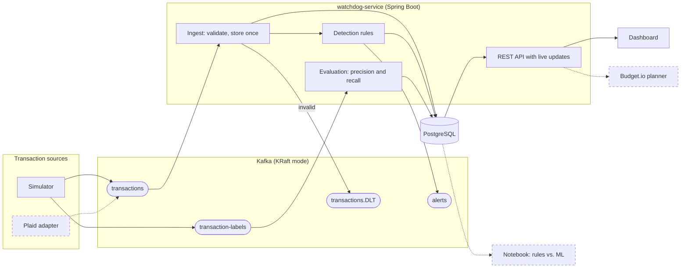

# Budget.io Watchdog: Design

Watchdog watches card transactions as they happen and flags two kinds of problems:

- **Money leaks:** duplicate charges, free trials that quietly turned into paid plans, subscription price hikes, and spending spikes.
- **Suspicious charges:** card testing (several tiny charges, then a big one) and charges from a country the card has never been used in.

It's the next version of Budget.io, my manual budget planner. This doc covers how Watchdog works, why I built it this way, and where it's going.

**Status:** Phases 1 to 3 are built and tested: the transaction pipeline; six detection rules that check every new transaction; alerts that are saved and published; a warm-up that rebuilds rule memory after a restart; precision and recall measured against the simulator's labels; a REST API with a live stream; health checks; and integration and API tests against real Kafka and Postgres. The stack also runs on a local Kubernetes cluster (kind), with demos of self-healing, readiness, scaling, and rolling updates (Phase 3.5a). A web dashboard shows the overview, a live feed, alerts, analytics, and recurring charges (Phase 4, with simulation controls and browser tests still to come). Everything else is planned and marked that way below.

## Roadmap

| Phase | What | Status |
|---|---|---|
| 1 | Transaction pipeline: a simulator, Kafka, and a Spring Boot service that validates transactions and stores them in PostgreSQL | Done |
| 2 | Six detection rules, with unit tests (hits are logged until Phase 3) | Done |
| 3 | Alerts, detection metrics (precision and recall), a REST API, integration and API tests | Done |
| 3.5 | Run the stack on a local Kubernetes cluster (kind) | In progress: the cluster and its demos (3.5a) are done; rule memory across pods (3.5b) is planned |
| 4 | Dashboard, with a Selenium end-to-end test | In progress: all five views are built; simulation controls and the Selenium test are next |
| 5 | CI with GitHub Actions, and benchmark results in the README | Planned |
| 6 | Data science: compare the rules with an ML model | Planned |

I'd like to finish the dashboard and CI before Phase 6, but Phase 6 only needs the simulator, the labels, and the rules' alerts, so I could also pick it up right after Phase 3.

## Background: Budget.io

Budget.io is a budget planner I built with React, TypeScript, and Vite. You type in your income, expenses, and debts, the data stays in your browser's localStorage, and an OpenAI-backed assistant gives budgeting advice. There's no transaction data: the closest thing is spending you enter by hand.

Its categories are free text. The defaults are Rent/Mortgage, Utilities, Food, and Transportation, and the budget breakdown adds a TP Fund ($100 or $200 of fun money), one line per debt, Savings, and an Emergency Fund.

### How Watchdog connects to it

Watchdog has a fixed list of categories. It's more detailed than Budget.io's because the rules need to tell dining apart from groceries, but every category rolls up into exactly one Budget.io line:

| Watchdog `Category` | Budget.io line |
|---|---|
| `INCOME` | the income field |
| `RENT` | Rent/Mortgage |
| `UTILITIES` | Utilities |
| `GROCERIES`, `DINING` | Food |
| `TRANSPORTATION` | Transportation |
| `SHOPPING` | TP Fund |
| `SUBSCRIPTIONS` | Subscriptions (a custom line) |
| `TRAVEL` | Travel (a custom line) |

Budget.io already supports custom expense lines, so the two new ones need no changes there. Phase 3 added an endpoint, `GET /api/spending/summary?userId=…&month=YYYY-MM`, that returns income and spending grouped by Budget.io line, so the planner could eventually fill itself in instead of relying on manual entry. Budget.io doesn't call it yet.

Two other differences from Budget.io:

- Money is stored as whole cents in a `long` (`amountCents`). Floats can't represent amounts like $0.10 exactly, so totals drift, and a `long` holds far more cents than I'll ever need.
- Budget.io has one implicit user per browser. Watchdog adds a `userId` and a `cardId` to every transaction.

## Architecture



Solid boxes and arrows exist today. Dashed ones are planned.

1. A source publishes each transaction to the `transactions` topic in Kafka, keyed by card. Right now the only source is the simulator, which also publishes a ground-truth label for every transaction to `transaction-labels`.
2. The watchdog reads `transactions`, validates each message, and stores it once in PostgreSQL. Messages it can't parse go to `transactions.DLT`.
3. The detection rules check each new transaction. Each hit becomes an alert with a plain-English explanation, saved to Postgres and published to `alerts`.
4. An evaluation step stores the labels and compares them with the alerts to measure precision and recall (`GET /api/stats`). The rules never see the labels.
5. A REST API with live updates serves what's stored to the dashboard (Phase 4). Planned: the Budget.io planner reads it too.

**Why Kafka sits in the middle.** The simulator never talks to the watchdog or the database directly. Kafka holds every message until the watchdog reads it, so the watchdog can go down, come back, and pick up where it left off. Stopping the watchdog for 20 seconds while the simulator kept running shows this: 130 transactions piled up in Kafka, and within seconds of the restart they were all stored, none lost. It also means other programs can read the same stream later without the simulator knowing about them. The tradeoff is that Kafka is one more system to run and understand.

## Phase 1: what's built

### The transaction message

Every source publishes this JSON to `transactions`, keyed by `cardId`:

```json
{
  "schemaVersion": 1,
  "transactionId": "5278a1ec-0766-3f2e-ba13-845077395928",
  "source": "SIMULATOR",
  "userId": "user-0001",
  "cardId": "card-0001",
  "merchant": "Blue Bottle Coffee",
  "category": "DINING",
  "amountCents": 545,
  "currency": "USD",
  "country": "US",
  "occurredAt": "2026-01-01T09:45:10Z",
  "publishedAt": "2026-10-27T23:40:46.732514085Z"
}
```

| Field | Type | Meaning |
|---|---|---|
| `schemaVersion` | int | Always 1 for this version. |
| `transactionId` | UUID | Unique per transaction. It's the idempotency key. |
| `source` | string | `SIMULATOR` today, `PLAID` later. |
| `userId` | string | Who owns the card. |
| `cardId` | string | The card (or account) the transaction posted to. Also the Kafka key. |
| `merchant` | string | Merchant name. |
| `category` | enum | One of the categories above. |
| `amountCents` | long, never negative | Money out, except `INCOME`, which is money in. |
| `currency` | ISO 4217 code | `USD` only for now. |
| `country` | ISO 3166-1 alpha-2 code | The merchant's country. |
| `occurredAt` | ISO-8601 instant | When the purchase happened (event time). For simulated data, this is the simulator's clock. |
| `publishedAt` | ISO-8601 instant | Real time when the source published it. End-to-end latency starts here. |

The decisions behind it:

- **Keyed by card.** Kafka only keeps messages in order within a partition, and messages with the same key always land in the same partition. Keying by card keeps each card's transactions in order, which the rules will depend on.
- **Two timestamps.** Rules will use `occurredAt` only, so they give the same answer however fast the simulator runs. Latency uses `publishedAt` and the real clock.
- **One contract, enforced.** The `Transaction` record in `transaction-schema` is shared by every Java producer and consumer, and its constructor rejects invalid values, so an invalid transaction can't exist in the code. All JSON reading and writing goes through one shared `MessageJson` configuration that's stricter than Jackson's defaults, because by default Jackson turns `15.49` into `15` and accepts `"1549"` as a number. A JSON Schema file (`transaction.v1.schema.json`) describes the same contract for sources written in other languages, and contract tests check that the record and the schema accept and reject the same messages.
- **JSON, not Avro.** JSON is readable in Kafka UI and in logs, and there's no Schema Registry to run. Avro or Protobuf with a registry would be the upgrade if the schema starts changing a lot.
- **Changing it later.** Consumers ignore fields they don't know, so a producer can add a field without breaking anyone. A breaking change would bump `schemaVersion`, and a consumer sends versions it doesn't understand to the DLT.

### Ground-truth labels

The simulator makes up every transaction, so it already knows which ones are problems. It publishes one label per transaction to `transaction-labels`, keyed by `transactionId`:

```json
{
  "schemaVersion": 1,
  "transactionId": "5278a1ec-0766-3f2e-ba13-845077395928",
  "persona": "STUDENT",
  "issueType": "NONE",
  "scenarioId": null,
  "edgeCase": null
}
```

- `issueType` is `NONE` for normal transactions, including legitimate ones that just look suspicious.
- It describes the transaction itself. In a duplicated charge, the original is `NONE` and the copy is `DUPLICATE_CHARGE`. For a free trial, the $0 or $1 signup is `NONE` and the first full charge is `TRIAL_CONVERSION`. On a binge day, every purchase in that category is `SPENDING_SPIKE`, because the spike is about the day's total. In card testing, the tiny probes and the big charge are all `CARD_TESTING`.
- `scenarioId` groups the transactions that belong to one injected issue or look-alike, like a duplicated pair, a trial and its conversion, or a whole trip. It's `null` for ordinary transactions.
- `edgeCase` names the legitimate look-alike a transaction belongs to, for error analysis.
- `persona` is there for analysis. It's never an input to detection.

Labels get their own topic on purpose. It's like keeping an exam's answer key in a separate folder from the questions: if the answers traveled with the transactions, detection could see them and the scores would mean nothing (in data science this is called label leakage). Real transactions, from Plaid for example, won't come with labels at all, so detection can't depend on them. Only the evaluation code will ever read this topic.

### The simulator

The simulator is a plain Java program, no Spring, that pretends to be a group of people spending money.

**A simulated clock.** Simulated time = start date + real time elapsed × speed. The demo runs one simulated month per real minute, so a day takes about 2 seconds, and free trials and subscription cycles that take weeks play out in under a minute. Setting `SIM_DAYS_PER_MINUTE=max` drops the waiting, which is what benchmarks and dataset generation need.

**Repeatable runs.** For each simulated day, every user's spending behaviors plan that day's transactions. The day is sorted by time, and each transaction is published when the clock reaches it. Simulated people live in UTC, which keeps time zones out of the picture. All randomness comes from one seed: a root generator hands each user their own stream with `SplittableRandom.split()`, in user order, so adding users never changes existing users' histories. Transaction IDs are name-based UUIDs built from the seed, the user, and a counter. The same settings always produce the same transactions, labels, and IDs, which makes results reproducible and makes a simulator restart harmless, because the watchdog skips IDs it already has.

#### Personas

Each user has one card, a home country of US, and a persona that sets their income, bills, habits, and how often they start free trials or travel:

| Persona | What it looks like |
|---|---|
| `STUDENT` | small biweekly paychecks, shared rent, coffee most mornings, lots of dining and delivery, 6 subscriptions, about one free trial a month, travels the least |
| `YOUNG_PROFESSIONAL` | a salary, rent, dining out, rideshare, 5 subscriptions, average travel |
| `FAMILY` | two paychecks, a mortgage, big grocery runs, higher utility bills, a car, the most shopping |
| `FREQUENT_TRAVELER` | a high salary, lots of dining out, rideshare, trips about five times as often as average |
| `RETIREE` | one monthly payment, steady bills, lower spending, a car, 3 subscriptions, rarely tries free trials |

The exact numbers are in `Persona.java`. Personas are assigned in exact proportion (`SIM_PERSONA_MIX`) with weighted round-robin, not by random draw, so 1,000 users at 25% students means exactly 250 students. The live demo runs 3 users (a student, a family, and a frequent traveler). The benchmark and the Phase 6 dataset will use about 1,000.

**Everyday spending:** biweekly or monthly paychecks, rent or mortgage on the 1st, monthly utilities (electricity and water vary, internet and phone don't), groceries, dining, coffee, gas or rideshare, shopping, 3 to 6 subscriptions depending on the persona, occasional free trials, and occasional trips. Amounts come from log-normal distributions, because real spending is skewed: lots of small purchases and a few big ones. Times of day follow the activity, like coffee between 7 and 10 am and paychecks at 6 am.

#### Injected issues and look-alikes

| Issue (`issueType`) | How it's injected | Legitimate look-alikes (`edgeCase`) | What a good rule should do |
|---|---|---|---|
| `DUPLICATE_CHARGE` | a card purchase posts again 5 to 90 seconds later | `DOUBLE_COFFEE`: the same coffee at the same price, 1 to 5 minutes apart (buying for a friend) | catch the duplicate; the double coffee is an expected false positive, and the same coffee hours apart must not fire |
| `TRIAL_CONVERSION` | a $0 or $1 trial converts to full price 7 to 30 days later | `CANCELLED_TRIAL` (no conversion); `APP_STORE_PURCHASES`: $0.99, then $9.99 at the same merchant 5 to 20 days later | catch the conversion; the App Store pair is an expected false positive |
| `PRICE_HIKE` | a subscription costs 10 to 25% more at renewal | utility bills that vary every month (ordinary behavior, not labeled) | catch the hike, never fire on utilities |
| `SPENDING_SPIKE` | a binge day: 3 to 5 extra purchases in dining or shopping | `LEGIT_BIG_PURCHASE` (like a laptop); spending during `LEGIT_TRAVEL` | catch the binge; the look-alikes are expected false positives |
| `CARD_TESTING` | 3 to 5 charges of $0.50 to $2.00 at different merchants, then one of $150 to $900, all within an hour | `TOLL_ROAD_TRIP`: several tolls, then a hotel, within an hour | catch the attack; the road trip is an expected false positive |
| `NEW_COUNTRY` | a charge from a country the card has never been used in | `LEGIT_TRAVEL`: a flight booked at home, then charges abroad; `FOREIGN_ONLINE_ORDER`: one order from a foreign shop with no trip | catch the fraud; stay quiet when a trip was booked first; the online order is an expected false positive |

The look-alikes exist so the metrics can't be trivially perfect. No issues or look-alikes are injected during a warm-up period (30 simulated days by default), because several rules need history first. Trips and injected fraud draw countries from the same neutral list, so no country is treated as inherently risky. Fraud uses fictional merchant names, so no real company is shown as a fraudster.

#### Configuration

The simulator reads environment variables, with defaults that work for a local run. `config/simulator.demo.env` is the preset that `docker compose up` uses.

| Variable | Demo value | Meaning |
|---|---|---|
| `SIM_SEED` | `42` | The seed for all randomness. |
| `SIM_USERS` | `3` | How many simulated people. |
| `SIM_PERSONA_MIX` | `STUDENT:1,FAMILY:1,FREQUENT_TRAVELER:1` | Persona weights, assigned in exact proportion. |
| `SIM_START_DATE` | `2026-01-01` | The first simulated day. |
| `SIM_DAYS_PER_MINUTE` | `30` | Simulated days per real minute, or `max`. |
| `SIM_DURATION_DAYS` | `0` | Stop after this many simulated days (0 runs until stopped). |
| `SIM_ISSUES_START_AFTER_DAYS` | `30` | The warm-up before anything is injected. |
| `SIM_RATE_*` | turned up | One rate per issue and look-alike. The unit is per card purchase, per renewal, per morning coffee, a share of free trials, or per user per day, depending on the rate. |
| `KAFKA_BOOTSTRAP_SERVERS` | `kafka:9092` | Where to publish. |

The demo turns the rates up so problems show up every few seconds. A benchmark preset (Phase 5) will keep problems rare, well under 1% of transactions, while still producing a few hundred of each type.

### Ingesting transactions

The watchdog is a Spring Boot app. For each message on `transactions`:

1. A `@KafkaListener` receives it. Three consumer threads share the topic's three partitions, so each card's transactions are handled in order by one thread.
2. It parses the JSON into a `Transaction`. A message that fails goes straight to `transactions.DLT`, with the reason in its headers and a warning in the log, so one bad message can't block a partition.
3. It stores the transaction with `INSERT ... ON CONFLICT (transaction_id) DO NOTHING`. If the row already exists, Kafka delivered the same message twice and the watchdog skips it. A duplicate message must never look like a duplicate charge.
4. A new transaction (not a skipped one) goes through the detection rules, described under Phase 2, and each hit is saved as an alert in the same database transaction (Phase 3).
5. The alerts are published to `alerts` (Phase 3).
6. Kafka's offset, its bookmark for where the watchdog is in the topic, gets committed after processing.

**When things go wrong:**

- **At-least-once delivery.** Offsets are committed after processing, so after a crash a message might be delivered again, but it's never lost. That's why every write has to be safe to repeat.
- **Bad data vs. outages.** Invalid messages go to the DLT right away, because retrying won't fix them. Anything else, like Postgres being down, gets retried with growing waits (1 second, doubling up to 30 seconds) without giving up. Skipping would lose a valid transaction and break per-card ordering, so the partition just waits. The catch is that a bug that throws on a valid message would also be retried forever and stall its partition, so the logs need watching.
- **Why not exactly-once?** Kafka transactions would add a lot of machinery. At-least-once delivery plus idempotent writes gives the same visible result here.

### Storage

PostgreSQL 18, with three tables so far:

| Table | Columns |
|---|---|
| `transactions` | every message field plus `processed_at` (when the watchdog stored it). Primary key `transaction_id`; indexes on `(card_id, occurred_at)` and `processed_at`. |
| `alerts` (Phase 3) | every alert message field plus `published_at` (when Kafka confirmed it; empty until then). Primary key `alert_id`, unique on `(transaction_id, detector)`, foreign key to `transactions`; indexes on `occurred_at` and `(user_id, occurred_at)`. |
| `ground_truth_labels` (Phase 3) | every label field plus `received_at`. Primary key `transaction_id`, no foreign key (a label can arrive before its transaction); index on `(issue_type, scenario_id)`. Only the evaluation code reads it. |

Flyway applies numbered SQL migrations at startup. A committed migration never changes; schema changes go in a new file. I went with Spring's `JdbcClient` and plain SQL instead of JPA: every query is visible, the planned stats need SQL features like `percentile_cont`, and there's no object graph for an ORM to help with.

### Running it locally

`docker compose up --build` runs everything:

| Service | Image | What it does | Port on your machine |
|---|---|---|---|
| `kafka` | `apache/kafka:4.2.2` | a single node acting as both broker and KRaft controller | 9094 |
| `kafka-init` | `apache/kafka:4.2.2` | creates the topics, then exits | none |
| `postgres` | `postgres:18.6-alpine` | storage | 5432 |
| `simulator` | built from `simulator/Dockerfile` | the transaction source | none |
| `watchdog` | built from `watchdog-service/Dockerfile` | consumer, rules, alerts, metrics, the REST API, health checks | 8082 |
| `kafka-ui` | `kafbat/kafka-ui:v1.5.0`, profile `tools` | browse topics and messages | 8081 |

| Topic | Partitions | Key |
|---|---|---|
| `transactions` | 3 | `cardId` |
| `transaction-labels` | 3 | `transactionId` |
| `transactions.DLT` | 3 | the original key. It needs at least as many partitions as `transactions`, because a failed message keeps its partition number. |
| `transaction-labels.DLT` (Phase 3) | 3 | the original key; labels the watchdog can't parse |
| `alerts` | 3 | `cardId` |

A few details:

- **Topics are created explicitly.** Kafka's automatic topic creation is off, so a typo can't silently create a one-partition topic. The `kafka-init` container creates them, and the apps wait for it to finish.
- **Port 8082 for the watchdog.** Budget.io's own server uses 8080, and Kafka UI has 8081, so all three can run at once.
- **Two Kafka listeners.** Containers connect to `kafka:9092`. Programs on your machine, like the watchdog run from an IDE, connect to `localhost:9094`.
- **Local only.** Every port is bound to 127.0.0.1, and the credentials are for local development only.
- **A throwaway demo.** Kafka and Postgres keep their data in memory (tmpfs), so every `docker compose up` starts a fresh, repeatable run. Without that, a restarted simulator would replay transactions the watchdog already has, and the demo would go quiet until it caught up. Kafka runs as a non-root user, so its tmpfs needs `mode=1777`. Restarting just the Postgres container wipes its data.
- **Images.** Each Dockerfile builds in the official `maven:3.9.16-eclipse-temurin-21-noble` image (the same Maven and Java as `./mvnw`) and runs on a smaller `eclipse-temurin:21` Java runtime image as a non-root user. Tests run in CI, not inside image builds.

### Testing (Phase 1)

Phase 1 added 78 unit tests:

- **`transaction-schema` (35):** contract tests that give the `Transaction` record and the JSON Schema the same valid and invalid messages and check that they agree, the label rules, and the Budget.io category mapping.
- **`simulator` (38):** the same seed gives identical data; adding users doesn't change existing ones; every transaction makes a valid message with exactly one label; nothing is injected during the warm-up; scenario counts land within 15% of their configured rates over 300 users and a simulated year; each scenario has the shape the rules will look for; plus the persona assignment and the clock math.
- **`watchdog-service` (5):** parsing, including that bad input becomes an `InvalidTransactionException` (renamed `InvalidMessageException` in Phase 3, when labels started using it too).

Manual checks on the running stack:

| Check | Result |
|---|---|
| Transactions reach Postgres | 88 to 126 rows in 10 seconds |
| Messages have the right keys | transactions keyed by card ID, labels by transaction ID |
| A malformed message | lands in `transactions.DLT` with the reason in its headers; the watchdog keeps running and logs a warning |
| The same message sent twice | still one row, logged as "already stored" |
| Simulator restarted | the 79 replayed messages were skipped, no duplicate rows |
| Postgres paused for 30 seconds | the backlog grew to 128 messages, then drained to 0 within 10 seconds, with nothing sent to the DLT |
| Watchdog stopped for 20 seconds | 130 transactions waited in Kafka and were all stored after the restart; the oldest was 30 seconds late |

With the simulator paused, the topic held 1,032 distinct transaction IDs and Postgres held exactly those 1,032 rows. On my laptop, steady-state latency from publish to stored was 9.6 ms at the median and 14.2 ms at the 95th percentile.

Integration tests with real Kafka and Postgres (Testcontainers), API tests, a browser end-to-end test, and CI come in Phases 3 to 5.

### What Phase 1 taught me

A few real bugs and surprises came up while building Phase 1. I'm keeping them here because each one changed the design.

- **Correlated random numbers.** The first version gave each user a seed of `seed ^ (n * 0x9E3779B97F4A7C15)`. That constant turns out to be `SplittableRandom`'s own internal step, so user 65 replayed user 1's numbers shifted by 64 draws, and 300 users behaved like about 64. The rate tests caught it: five scenario counts came out 20 to 25% too high. Switching to `split()` fixed it.
- **Lenient JSON.** By default, Jackson truncates `15.49` to `15` and accepts the string `"1549"` as a number. That's why all message parsing goes through `MessageJson`, and why the contract tests cover both cases.
- **A silent dead-letter topic.** The first malformed-message check worked, but the watchdog logged nothing, so bad data could pile up unnoticed. It now logs a warning with the reason for every message it sends to the DLT.
- **Kafka couldn't write its data.** The first `docker compose up` failed because Kafka runs as a non-root user and the in-memory folder wasn't writable. The fix was `mode=1777` on the tmpfs mount.
- **One checksum, two downloads.** The Maven wrapper downloads a `.zip` when `unzip` is installed and a `.tar.gz` when it isn't, and a pinned checksum can only match one of them. That's why the Docker builds use the official Maven image instead of `./mvnw`, which means Maven's version is pinned in two places.
- **Checking the check.** The first "did every transaction make it to Postgres?" comparison read the topic while the simulator was still writing to it and reported 12 extra rows, which looked like a bug. Pausing the simulator gave a clean comparison, and the counts matched exactly.

## Phase 2: what's built

Six detection rules check every new transaction. Each rule is its own class behind one interface, so adding a rule means adding a class, and a `RuleEngine` runs them all:

```java
public interface DetectionRule {
    String id();                                // "duplicate-charge"; Phase 3 stores it as the detector's name
    IssueType detects();                        // the one issue type this rule is scored against
    Optional<RuleHit> evaluate(Transaction tx); // checks tx against this rule's per-card history, then updates it
}
```

Each rule says which issue type it detects, so Phase 3 can score it against the labels, and an ML model can later be scored the same way. A hit carries the rule's ID, that issue type, and a plain-English explanation with the numbers behind it. Until Phase 3 adds alerts, the listener logs each hit:

```
Rule hit duplicate-charge on card-0002 at 2026-03-08T18:57:45Z (transaction c1ff7a9f-99d1-34a8-a5a0-2b0719ce3f42): Whole Foods Market charged $140.84 twice, 24 seconds apart.
```

### The rules

| Rule | Kind | Fires when | Example explanation |
|---|---|---|---|
| `duplicate-charge` | leak | the same merchant and amount on the same card within 10 minutes | "Whole Foods Market charged $87.42 twice, 40 seconds apart." |
| `trial-conversion` | leak | a charge of $1 or less, then the same merchant charges more than $1 and at least 5 times as much, 5 to 45 days later; once per trial | "Peacock charged $10.99, 12 days after a $0.00 charge. A free trial may have turned into a paid plan." |
| `price-hike` | leak | a merchant's last two charges were 26 to 35 days apart and within 1% of each other, and the next one, 26 to 35 days later, is more than 1% higher | "Netflix charged $17.99, up from $15.49 last month." |
| `spending-spike` | leak | today's dining or shopping total reaches 3 standard deviations above this card's usual day in that category; needs 14 days with spending and at least $50 today; once per category per day | "You've spent $182.40 on dining today. On a usual dining day this card spends about $30.00." |
| `card-testing` | suspicious | 3 or more charges of $2 or less in the 60 minutes before a charge of $100 or more; once per burst | "3 charges of $2.00 or less in the 25 minutes before a $412.50 charge at ElectroMart Online. Someone may be testing your card number." |
| `new-country` | suspicious | a charge from a country the card isn't normally used in, unless there was a travel purchase in the last 30 days; needs 20 earlier transactions; flagged countries aren't learned, so fraud can't teach the rule it's normal | "$812.40 at Luxury Goods Outlet (France), a country this card isn't normally used in, with no travel purchases in the last 30 days." |

"Suspicious charge" is split into two rules so each class does one thing and gets its own precision and recall. Two refinements came from reviewing the rules:

- **Trial conversions and holds.** While reviewing the rule, I realized a gas-pump hold could still trigger a false alert a week later: a $1 hold, the real fill-up minutes later, then next week's fill-up at the same station. Now a charge over $1 from the same merchant within the first 5 days makes the rule forget the small charge, since that was a hold or a purchase, not a trial. On the prototype data (below) it removed 88 false positives without missing any real conversions.
- **Explanations that stay true.** A third identical charge says "charged $5.45 again, 60 seconds after an identical charge", because "twice" would be wrong. New-country doesn't say "first charge from France", because a flagged country isn't learned and fires again on its next charge.

### How every rule works

- **Event time only.** Rules compare `occurredAt` values and never read the clock, so they give the same answer at any simulator speed.
- **Check, then learn.** A rule checks a transaction against what it knew before, then adds it. Learning first would make every charge a duplicate of itself, and a hotel abroad could count as the travel purchase that excuses itself.
- **Only general signals.** Amounts, timing, categories, and the card's own history. No merchant names or country lists, so the rules can't learn the simulator's giveaways (fictional fraud merchants, the fixed list of probe merchants), and they'd work the same on Plaid data.
- **Each new transaction once.** The listener only runs the rules when the insert was new, so a message Kafka delivers twice never reaches them.
- **Income is skipped** by the engine.
- **One broken rule can't hide the others.** The engine catches an exception from a rule, logs it at ERROR, and runs the rest. Rethrowing wouldn't help: Kafka's retry would find the transaction already stored and silently skip every rule.
- **Time order and days.** Each card's transactions are assumed to arrive in time order, which the simulator and the per-card keying guarantee. Days are UTC days, like the simulator's people.

### Where each card's history lives

The rules need history: recent charges, running averages, countries seen. The options I looked at:

| Option | Pros | Cons |
|---|---|---|
| **In memory inside each rule, keyed by card, rebuilt from Postgres at startup (my pick)** | fast, simple, and the rules can be unit tested with no infrastructure | lives in one process; running several watchdogs would mean rebuilding state whenever partitions move |
| Query Postgres for every transaction | always durable, nothing to rebuild | a database round trip per rule per transaction, and rule tests need a database |
| Kafka Streams state stores | the standard streaming answer; durable, and handles partitions moving | a lot of new concepts for this project |
| Redis | shared and fast | another service to run and explain |

Each rule keeps its history in memory, in a map keyed by card. It stays small: time windows are pruned on every transaction, merchants and small charges that can't matter anymore are dropped, and the spending-spike rule keeps three running numbers per category (Welford's algorithm, below). Unit tests feed one card a simulated year of transactions and check that each windowed rule's memory stays bounded.

Each card normally arrives on one consumer thread, but the engine still takes a per-card lock around that card's rules. The lock is almost never contended, because only one thread usually asks for a given card. It's there because Kafka can move a partition to another thread: during testing, two partitions moved at startup, about 3 seconds in. Java only guarantees that the new thread sees the old thread's changes to a card's history if they hand over through a lock. The same lock covers the Phase 3 warm-up, which replays history on a different thread.

Since Phase 3, the history is rebuilt at startup from Postgres (the warm-up, below). Scaling out to several watchdogs would mean rebuilding a card's history whenever its partition moves to another instance (planned for Phase 3.5) or moving to Kafka Streams.

### Thresholds

Every threshold lives in `application.yml` under `watchdog.rules.*`, can be overridden with an environment variable (for example `WATCHDOG_RULES_DUPLICATECHARGE_WINDOW=5m`), and is checked at startup: a bad or missing value stops the app with a message that names the setting. They're starting values I'll tune against real metrics in Phase 3. Several came straight from how I built the simulator, so the last column says where each one came from.

| Setting | Value | Why this value | Came from |
|---|---|---|---|
| `duplicate-charge.window` | 10 min | A glitch reposts a charge within seconds to minutes. The simulator's copies land 5 to 90 seconds later, and its double coffees 1 to 5 minutes later, so this window catches both. | both |
| `trial-conversion.max-trial-cents` | $1.00 | Trials sign up for $0 or with a $1 card check. | both |
| `trial-conversion.min-multiple` | 5× | A paid plan costs many times a $1 check. The simulator's plans cost $10.99 to $69.99. | simulator |
| `trial-conversion.min-delay` | 5 days | Sooner than that is a hold followed by the real charge, like at a gas pump, not a trial. | real world |
| `trial-conversion.max-delay` | 45 days | Real trials usually last 7, 14, or 30 days, so the first full charge lands in this range with some margin. The simulator converts at 7 to 30 days. | both |
| `price-hike.min-gap`, `max-gap` | 26 to 35 days | Monthly billing lands 28 to 31 days apart, plus time of day and short months. | real world |
| `price-hike.tolerance-percent` | 1% | Subscriptions repeat the exact price; 1% leaves room for small rounding or tax changes. The simulator's hikes are 10 to 25%. | both |
| `spending-spike.categories` | dining, shopping | The impulse categories; fixed bills can't spike and broke the math (below). Also where the simulator plants binges. | both, disclosed |
| `spending-spike.min-std-devs` | 3 | The usual line for "far from normal". Real spending is skewed, so it fires more often than the normal math predicts. | real world |
| `spending-spike.min-history-days` | 14 | Fewer days with spending give a noisy baseline. | real world |
| `spending-spike.min-day-total-cents` | $50 | A spike under $50 isn't worth an alert, even when it's unusual. | real world |
| `card-testing.max-probe-cents` | $2.00 | Card testers use tiny amounts to avoid notice. The simulator's probes are $0.50 to $2.00. | both |
| `card-testing.min-probes` | 3 | One small charge is normal, like an app or a toll; several in an hour is the pattern. The simulator's attacks use 3 to 5. | both |
| `card-testing.window` | 60 min | Attacks are quick, and the simulator's always fit within an hour. | simulator |
| `card-testing.min-charge-cents` | $100 | The cash-out is a real purchase. The simulator's are $150 to $900. | simulator |
| `new-country.min-prior-transactions` | 20 | A brand-new card needs a little history before "new country" means anything. | real world |
| `new-country.travel-lookback` | 30 days | People book flights before the trip. The simulator books 5 to 25 days ahead, and a 14-day window did worse on the demo data. Real people often book further out (see Known limitations). | both |

### Spending spike: categories and baseline

Two decisions here came from checking the rule against the simulator's labels before writing any Java. Throwaway Python prototypes of all six rules ran over a snapshot of the demo stack: 203,086 transactions, 3 users, about 60 simulated years. **These are demo-rate prototype numbers.** The demo plants problems far more often than real life, so they show how the variants compare, not real-world performance.

- **Categories.** Watching every category broke the rule: rent fired on 978 of 1,020 rent days, because its standard deviation is 0, and subscriptions fired 1,060 times. Groceries and transportation only fired on ordinary days, like two grocery runs in one day. I watch dining and shopping: they're the impulse categories, and fixed bills like rent and subscriptions aren't spikes. These are also the two categories where my simulator plants binges, which makes the rule look better on this data than it may on real data.
- **Days with no spending aren't in the baseline.** Otherwise a once-a-week shopper's usual shopping day would be about $5, and every normal trip would look like a spike.
- **Baseline.** Every finished day joins the baseline, spikes included. I'd rather have fewer false alarms and a baseline that adapts than catch every spike, because people stop trusting alerts that fire too often. The variants I compared:

| Variant | Alerts | Precision | Recall |
|---|---|---|---|
| **Dining and shopping, learn every day (chosen)** | 1,343 | 43% | 50% |
| Dining and shopping, skip flagged days | 4,997 | 22% | 96% |
| Dining and shopping, clip flagged days | 2,102 | 30% | 55% |
| Dining and shopping, learn every day, log amounts | 21 | 90% | 2% |
| Four everyday categories, learn every day | 1,837 | 32% | 50% |
| Four everyday categories, skip flagged days | 5,930 | 19% | 96% |
| Four everyday categories, clip flagged days | 2,702 | 24% | 55% |
| Four everyday categories, learn every day, log amounts | 70 | 27% | 2% |

"Four everyday categories" adds groceries and transportation. "Clip" learns the threshold a flagged day crossed instead of the day's real total. "Log amounts" runs the statistics on the log of each day's total, which suits skewed data, but at the same 3-standard-deviation line it almost never fires. Recall is low for the chosen variant because the demo plants a $749 to $1,299 purchase about every 50 days per person, and one outlier widens the baseline for a while. The simulator's default rates are 10 times rarer, so recall should be better at benchmark rates; Phase 5 will measure it.

**Welford's algorithm** keeps three numbers per card and category: the count, the mean, and the sum of squared distances from the mean, updated as each day finishes. The textbook shortcut, a sum and a sum of squares, subtracts two huge, nearly equal numbers: on four values near a billion cents it returns a variance of 0 instead of 30, which a unit test shows.

### Testing (Phase 2)

`./mvnw verify` now runs 183 unit tests, none needing Docker: 35 schema, 38 simulator, and 110 in `watchdog-service` (5 parsing, 105 rules):

- **Each rule:** fires, doesn't fire, exact window and threshold boundaries, its look-alikes from the simulator, and isolation between cards. The rules with windows also get a year of transactions on one card, to check their memory stays bounded.
- **Welford:** matches a two-pass calculation, and stays accurate near a billion.
- **The engine:** rules run in ID order, income is skipped, a rule that throws doesn't stop the others, and two threads sending one card's transactions at the same time don't lose updates. With the lock removed, that test lost 112 of 100,000.
- **Determinism:** the same transactions give the same hits, however the cards are interleaved.
- **Wiring:** Spring loads six rules from the real `application.yml`, each issue type has exactly one rule, and bad settings stop startup.
- **A guard test** fails if any rule's source mentions the labels, their topic or table, or the evaluation package.

Checks on the running stack:

| Check | Result |
|---|---|
| The watchdog starts with all six rules | the startup log lists them, on every start |
| All six rules fire on a fresh run | within 4 minutes 40 seconds of `docker compose up`, about 140 simulated days |
| Java rules vs. the Python prototypes on the same transactions | identical hits on both runs: 448 on the first (8,819 transactions), 339 on the second (6,542) |
| A stored message sent again | logged as "already stored", and no new hit |
| Same seed, two fresh runs | identical hits up to the same simulated day: 339 hits before December 26, 2027, even though the first run went through a laptop sleep and a rebalance and the second had the per-card lock |
| Latency with the rules running | p50 10.4 ms, p95 16.6 ms, against 9.0 ms and 11.4 ms for Phase 1 measured the same way the same day. The new JVM was 9 minutes old and its median was still falling, so part of the difference is warm-up. |
| Watchdog restarted mid-run | back in 2 seconds with six rules and no errors; card-testing and duplicate-charge fired again within 2 simulated days, spending-spike after 19, price-hike after 72, as expected with empty memory |

What the rules flagged on run 1 (8,819 transactions, 970 simulated days), scored against the labels. **These are demo-rate numbers:** the demo plants problems far more often than real life, so they show how each rule behaves, not real-world performance.

| Rule | Alerts | Precision | Recall | Most false positives were |
|---|---|---|---|---|
| `duplicate-charge` | 133 | 49% | 100% of 65 | double coffees (66) |
| `trial-conversion` | 52 | 25% | 100% of 13 | App Store pairs (39) |
| `price-hike` | 87 | 95% | 86% of 96 | ordinary charges (4) |
| `spending-spike` | 60 | 30% | 42% of 43 | big purchases (16), ordinary days (12), fraud abroad (8) |
| `card-testing` | 104 | 52% | 100% of 54 | toll road trips (50) |
| `new-country` | 12 | 92% | 61% of 18 | one foreign online order |

Each rule's false positives are mostly the look-alike the simulator plants for it, which is what the design expects. Real precision and recall, computed by the service itself, come in Phase 3.

### What Phase 2 taught me

- **Check a rule against the data before writing it.** Prototyping the spending-spike rule in Python showed that watching every category fails: rent has a standard deviation of 0, so every rent day looked like a spike. That decided the categories before any Java existed.
- **A retry can hide a bug.** If a rule throws, Spring retries the message, but the transaction is already stored, so the retry logs "already stored" and skips every rule. A bug would have looked like a duplicate message. That's why the engine catches rule failures itself.
- **A gas-pump hold.** Reviewing trial-conversion, I found that a $1 hold followed by the real fill-up would make next week's fill-up look like a converted trial. The fix removed 88 false positives on the prototype data.
- **One outlier widens the baseline.** Learning every day, including spikes, means a single huge day makes the next spike harder to catch for a while. I chose that knowingly (above).
- **Kafka moves partitions, even inside one process.** The plan said each card stays on one thread, so no locking was needed. On the first test run, two partitions moved between threads at startup, so the engine now takes a per-card lock.
- **A laptop's sleep broke a measurement.** The first run's latency came out at 713 ms. The Mac had gone to sleep on battery, Docker paused with it, and on each wake the simulator published the missed simulated days in a burst. The rules weren't the cause; the run was measured again with the Mac awake.
- **The cross-check found a bug in the checker.** The first Java-versus-Python comparison said every line differed. Python's CSV writer ends lines with `\r\n`; once fixed, the hits matched exactly.
- **Long runs use up the simulator's scenarios.** Each user can try each of the 7 trial offers once and visit each of 10 countries, so a 60-year run had only 13 trial conversions and 18 new-country frauds, against hundreds of App Store pairs. Fine for the demo and a one-year benchmark, but worth knowing before reading long-run numbers.

## Phase 3: what's built

Phase 3 was built in three parts: alerts, the warm-up, and what Kubernetes will need (Phase 3.5); then labels and detection metrics; then the REST API and the live stream.

### Alerts

Every rule hit becomes an alert. Like the other messages, it has a record in `transaction-schema` (`Alert`), a JSON Schema (`alert.v1.schema.json`), and a contract test that checks the two agree:

```json
{
  "schemaVersion": 1,
  "alertId": "7729bf53-4c4e-35dd-9b61-d1428bf6a33e",
  "transactionId": "c1ff7a9f-99d1-34a8-a5a0-2b0719ce3f42",
  "userId": "user-0002",
  "cardId": "card-0002",
  "detector": "duplicate-charge",
  "issueType": "DUPLICATE_CHARGE",
  "explanation": "Whole Foods Market charged $140.84 twice, 24 seconds apart.",
  "occurredAt": "2026-03-08T18:57:45Z",
  "detectedAt": "2026-10-29T04:07:24.093435969Z"
}
```

- **`detector`** is plain text: a rule's ID today, and a model's name if an ML detector adds alerts later, with no schema change.
- **`alertId`** is a name-based UUID built from the transaction ID and the detector, so the same alert always gets the same ID, even when it's published again.
- Alerts are saved in the `alerts` table (one per transaction and detector) and published to the `alerts` topic, keyed by card.
- The listener still logs every hit (`Rule hit duplicate-charge on card-0002 ...`), so the logs read the same as in Phase 2.

### Saving an alert and publishing it

For each new transaction:

```
one Postgres transaction:
    insert the transaction            (already stored? skip the rules, see below)
    run the rules
    insert the alerts                 (published_at empty)
commit
publish each alert, wait for Kafka to confirm it, fill in published_at
commit the Kafka offset
```

**The gap this closes.** In Phase 2 the transaction insert committed on its own, before the rules ran. If saving the alerts had failed after that, Kafka's retry would have found the transaction already stored and skipped the rules, and the alerts would have been lost. Running the rules again wouldn't have been safe either, because their memory had already learned the transaction: duplicate-charge would have matched it against itself.

Now the transaction row and its alerts commit together, so if saving an alert fails, both roll back and the retry sees the transaction as new. The rules still remember the failed attempt, though, so the engine keeps each card's last transaction ID and the hits it produced. If the same transaction comes back, the engine returns those hits without running the rules again. That's safe because a retry is always the card's latest transaction: each card is on one partition, and Spring's error handler retries the failed message before anything after it. After a crash, the warm-up rebuilds memory from Postgres, which doesn't have the rolled-back row, so the redelivered message is evaluated from scratch.

I looked at two other fixes. Rebuilding the card's memory from Postgres before each retry reuses the warm-up, but it's slow and its 90-day memory can give slightly different later hits. Splitting every rule into "check" and "learn" is the most direct, but it touches all six rules and their tests, and several rules change their memory while checking.

**Saving and publishing aren't one step (the outbox problem).** Postgres and Kafka are two systems, so there's no single commit that covers both. A crash or an error between the two writes can leave them disagreeing. The usual fix is the **transactional outbox pattern**: write the outgoing message into an outbox table in the same database transaction as the data, and have a separate relay read the outbox and publish it, marking each row once Kafka confirms. The relay either polls the table or reads the database's change log, with a tool like Debezium.

Watchdog uses a lighter version of the same idea. The `alerts` table is the outbox, with `published_at` as the "sent" mark, and Kafka's redelivery is the relay. If publishing throws, the error handler retries the message; the retry finds the transaction already stored and publishes that transaction's alerts that are still unpublished. If the process dies before publishing, the offset was never committed, so Kafka redelivers the message and the same thing happens.

What it covers and what it doesn't:

- An alert that's saved always gets published eventually.
- **Duplicates are possible.** If Kafka confirms an alert and the process dies before `published_at` is filled in, the redelivery publishes it again, with the same `alertId`. Anything that reads `alerts` should drop duplicates by `alertId`.
- A Kafka outage stalls the partition, just like a Postgres outage, because publishing happens on the consumer thread. A real relay would let ingest keep going while Kafka is down.
- It only works because every alert is written while handling a message Kafka will redeliver. Alerts from anywhere else would need a real relay.

### Warm-up

At startup, before the Kafka listener starts, the watchdog replays recent history from Postgres through the rules and throws the hits away (their alerts were raised the first time):

- The window is 90 simulated days (`watchdog.warm-up.lookback`), counted back from the newest stored `occurred_at`, never from the wall clock, because the demo's simulated time runs years ahead. It covers the longest look-back: price-hike needs two earlier monthly charges.
- Each card is replayed in the order it was stored, which is the order the live rules saw it.
- Rows are streamed from Postgres in batches, so a large table isn't loaded into memory at once.
- The listener is created with `autoStartup = false`, and the warm-up starts it when it's done. That matters for Kubernetes: Kafka hands partitions to any consumer that joins, ready or not, so the app itself has to hold off.
- Spring Boot only reports the app as ready once startup code like the warm-up has finished, so `/actuator/health/readiness` says `OUT_OF_SERVICE` until then.

The log shows what it did. On the demo, after about 8 simulated months: `Warm-up finished: replayed 818 transactions on 3 cards, from 2026-06-01T21:20:15Z to 2026-08-30T21:20:15Z, in 35 ms`.

It only covers 90 days, so a restarted watchdog isn't exactly the same as one that never stopped. A country the card only used more than 90 days ago is forgotten, so a charge there can fire new-country once. Spending-spike's baseline is rebuilt from 90 days instead of all history.

### Health, shutdown, and configuration

These are what Phase 3.5 needs:

- **Health checks.** Spring Boot Actuator serves `/actuator/health`, plus `/actuator/health/liveness` and `/actuator/health/readiness`. Liveness only says whether the app itself is broken; it doesn't check Kafka or Postgres, because restarting the watchdog wouldn't fix either. Readiness turns `UP` after the warm-up.
- **Graceful shutdown.** On SIGTERM, the web server stops taking new requests, and the Kafka listener finishes the message in hand, commits its offset, and leaves the consumer group, so its partitions move right away. Each shutdown step gets up to 30 seconds (Phase 3.5 gives a pod 45).
- **Consumer threads** come from one setting, `watchdog.listener.concurrency` (`WATCHDOG_LISTENER_CONCURRENCY`): 3 in Compose, 1 per pod in Kubernetes.
- All configuration still comes from environment variables, and logs still go to stdout.

### Detection metrics

The simulator's labels are stored in `ground_truth_labels` by a separate listener in the `evaluation` package, in its own consumer group, so labels never pass through the detection code. A guard test checks that nothing in `rules`, `ingest`, or `alerts` mentions them. A label that can't be parsed goes to `transaction-labels.DLT`; each topic's bad messages now go to that topic's own dead-letter topic.

`GET /api/stats` compares the alerts with the labels on every request, with two SQL queries, and returns per rule:

| Field | Meaning |
|---|---|
| `alerts` | everything the rule raised |
| `truePositives` | alerts on transactions labeled with the rule's issue type |
| `falsePositives` | alerts on transactions labeled with anything else (look-alikes are labeled `NONE`) |
| `unlabeledAlerts` | alerts whose label hasn't arrived yet, or never will (real bank data has no labels); not scored |
| `scenarios` | injected scenarios of the rule's issue type whose transactions are stored |
| `caughtScenarios`, `falseNegatives` | scenarios with at least one true positive alert, and the rest |
| `precision` | true / (true + false) positives; `null` with no labeled alerts yet |
| `recall` | caught / all scenarios; `null` with no scenarios yet |

- **Precision counts alerts; recall counts scenarios.** A scenario is one injected incident, like a duplicated pair or a whole card-testing attack, so a caught attack counts once whichever of its charges the alert fired on. A hit on the untouched original of a duplicated pair (labeled `NONE`) is a false positive and doesn't catch the scenario.
- **Missing labels.** Labels arrive on their own topic, so a transaction can be stored before its label. Only alerts and scenarios with both are scored; the rest show up as `unlabeledAlerts`, and a ratio with nothing to divide is `null`, not 0, because "no data yet" isn't "0%". My Python prototypes count it differently: an unlabeled alert is a false positive, and an empty ratio is 0. On a paused, caught-up run every transaction has its label, so both give the same numbers, which is how the service was checked against the prototypes (below).
- **Throughput** is transactions stored per second over the last 60 seconds. **Latency** is `processed_at - published_at` over the last 5 minutes, as the median, 95th, and 99th percentile (Postgres's `percentile_cont`, which interpolates between neighbors). Both use the real clock, and latency assumes the simulator and the watchdog share one, which is true on one machine.
- Everything is computed on request. That's cheap at demo size; Phase 5's benchmark will show whether it needs caching at 1,000 users.

### The REST API

The API reads Postgres, so it answers the same from any watchdog instance. Money is in cents and times are ISO-8601 in UTC, like the messages.

| Endpoint | Returns |
|---|---|
| `GET /api/transactions?userId=&limit=` | the newest transactions, by event time (`userId` optional; `limit` 1 to 500, default 50) |
| `GET /api/alerts?userId=&detector=&limit=` | the newest alerts with their explanations (`detector` is a rule ID) |
| `GET /api/recurring?userId=` | the user's recurring charges: merchant, category, price, previous price, status, last charge, next expected charge, yearly cost |
| `GET /api/stats` | totals (transactions and alerts stored, added in Phase 4); per rule precision, recall, and counts; throughput and latency (above) |
| `GET /api/users` | added in Phase 4: each user ID with their card IDs, transaction count, and newest transaction time |
| `GET /api/activity?days=` | added in Phase 4: transactions, spending, and alerts per simulated day for the last `days` days (1 to 365, default 30) up to the newest transaction, zeros included |
| `GET /api/spending/summary?userId=&month=YYYY-MM` | the month's income, and spending per Budget.io line, zeros included, in a fixed order |
| `GET /api/stream` | live `transaction` and `alert` events, as Server-Sent Events |

- **Bad parameters** get a 400 with Spring's standard problem JSON (RFC 9457), whose `detail` says what was wrong: a `limit` that isn't a number or is out of range, a missing `userId` where it's required, a month that isn't `YYYY-MM`, or a detector that isn't a rule ID (a typo would otherwise quietly return nothing). The checks are a few lines by hand, with no validation library. An unknown user isn't an error: they get an empty list or zeros.
- **"Now" is the user's newest transaction,** never the wall clock, for anything that needs it (a recurring charge's status and next expected date), because the demo's simulated time runs years ahead.
- **Recurring charges** are worked out on each request from the user's last 105 simulated days (three monthly gaps), reading each merchant's charges in the order they happened (event time). The rules follow arrival order because they stream; the API reads history, so a charge that arrives late still lands where it belongs. They use the price-hike rule's own check, now a shared `MonthlyPattern` class, so the list and the alerts always agree. A merchant whose last two charges were a month apart at a steady price is `ACTIVE`; steady for two months and then more than 1% higher is `PRICE_UP`, which is exactly what price-hike alerts on; monthly but not steady is `VARIES` (added in Phase 4; the response's previous and current price show the change); no charge for more than 35 days after the last one is `OVERDUE`. That includes rent, internet, and phone bills, not only subscriptions, which is why they're called recurring charges. A bill whose price moves every month, like electricity, is `VARIES`, and so is a subscription that went up two months running: price-hike only fires after a steady stretch, so the second hike isn't `PRICE_UP`, but it stays on the list. Nothing is stored, so there's no second copy of anything to keep in sync.
- **The spending summary** adds up the month (UTC) per category and rolls the categories up into Budget.io's lines (groceries and dining are both Food). It's the one endpoint with CORS, because Budget.io would call it from the browser: the allow-list is `watchdog.api.cors-allowed-origins` (`WATCHDOG_API_CORSALLOWEDORIGINS`), Budget.io's Vite dev server by default. The dashboard (Phase 4) will be served from the same origin as the API, so it needs none.
- **The live stream** uses Server-Sent Events instead of WebSockets because the data only flows one way, and browsers reconnect by themselves. The Kafka listener hands each new transaction and alert to one background thread that sends them to every open connection, so a slow browser can't hold up Kafka; if that thread falls 1,000 events behind, new events are dropped and counted in the log. Open streams are closed first at shutdown, so they don't hold up graceful shutdown. It only shows what its own process handled: with several watchdog instances (Phase 3.5), each stream shows the cards on that instance's partitions.
- New indexes on `transactions` (`occurred_at`, and `(user_id, occurred_at)`) keep the newest-first lists and the per-user reads from scanning the table.

### Testing (Phase 3)

`./mvnw verify` now also runs integration tests (`*IT`, through Maven Failsafe) against a real Kafka and a real Postgres in Docker containers (Testcontainers), the same images as Compose. So `verify` needs Docker running.

- **Unit tests (221):** 40 schema (including the alert contract), 38 simulator, 143 in `watchdog-service`. New: the engine hands back the same hits for a retry and runs the rules normally for the next transaction; the warm-up replays before it starts the listener; the label guard test now also covers the `ingest` and `alerts` packages; the precision and recall math, including every divide-by-zero case; the monthly check's edges; recurring charges (steady, a hike, rent, a varying bill, a bill that went up this month, back-to-back hikes, a weekly merchant, a single charge, overdue, income); the spending summary's roll-up into Budget.io lines.
- **Integration tests (30):**
  - a duplicated charge gives one alert row and one alert message, keyed by card, marked published;
  - a resent message never reaches the rules (if it did, duplicate-charge would match it against itself);
  - when saving an alert fails once, the retry saves exactly one alert, and its explanation says "twice", not "again", so the rule learned the charge once;
  - when publishing fails once, the retry publishes the saved alert, and every copy on the topic has the same alert ID;
  - a real restart: the second run raises a price hike and a new-country charge that it could only catch if the warm-up replayed the card's history, and a country used only before the 90-day window is forgotten. With the window shrunk to one minute, the test fails, as it should;
  - the metrics queries on hand-made rows covering each case: a caught duplicate, an alert on the untouched original (a false positive that doesn't catch the scenario), a look-alike, a charge posted three times (two true alerts, one scenario), an unlabeled alert, a label whose transaction hasn't arrived, and an attack nobody caught;
  - throughput and latency on known values (eleven latencies with known percentiles), and an empty window giving nulls;
  - a label sent twice is stored once; a bad label goes to `transaction-labels.DLT`, and a bad transaction still goes to `transactions.DLT`;
  - `GET /api/stats` over real HTTP with REST Assured: one score per rule, every field present even when it's null;
  - every other endpoint over real HTTP, on rows written for one user so the expected numbers can be worked out by hand: newest-first transactions with a limit, alerts filtered by detector, recurring charges (`ACTIVE`, `PRICE_UP`, a varying bill left out), a month's summary with both of its edges, an unknown user, ten bad parameters each getting a 400 problem JSON that names the problem, and CORS allowed for Budget.io's origin on the summary only;
  - a client connected to `/api/stream` receives the two transactions and the alert of a duplicated charge sent through Kafka.

Checks on the running stack (demo preset, 2026-10-29):

| Check | Result |
|---|---|
| Every rule raises alerts | all six within 3 minutes 10 seconds of `docker compose up` |
| Nothing lost | with the simulator paused and lag 0: 104 alerts in Postgres, all marked published, and exactly the same 104 alert IDs on the `alerts` topic, with no duplicates |
| A stored message that had an alert, sent again | "Skipped … already stored", still one alert, nothing republished |
| Postgres paused for 30 seconds | lag grew to 136 and was back to 0 within 5 seconds of unpausing; nothing in the DLT, and the alert check above still matched |
| Java rules vs. the Python prototypes | identical: 104 hits each, on 1,938 transactions |
| `docker compose restart watchdog` | readiness answered 503 while the app shut down and for about 0.1 s while the warm-up ran (818 transactions on 3 cards in 35 ms), then 200; price-hike fired again 10 simulated days after the restart, against 72 days in Phase 2 without a warm-up |
| `docker compose stop watchdog` | stopped in 0.6 seconds: partitions revoked, consumers stopped, then the web server; the next start found 0 messages "already stored", so the offsets of everything processed were committed |
| `WATCHDOG_LISTENER_CONCURRENCY=1` | one consumer owned all three partitions; back to three consumers without it |
| Same seed, two fresh runs | the same 104 alerts (IDs, detectors, explanations, times) up to the same simulated day |

Checks for the metrics, on a fresh run (demo preset, 2026-10-29):

| Check | Result |
|---|---|
| Every transaction gets its label | with the simulator paused and both consumer groups at lag 0: 933 transactions and 933 labels, none missing |
| The service vs. the Python prototypes | `/api/stats` matched `prototypes.py score` exactly for all six rules: alerts, precision, recall, and scenario counts |
| A malformed label | landed in `transaction-labels.DLT` (same partition), with a warning in the log; `transactions.DLT` stayed empty |
| Throughput and latency, steady state | 4.8 transactions per second at the demo's pace; p50 10.1 ms, p95 15.9 ms, p99 26.3 ms over 1,376 transactions, the same as a direct `psql` query and in line with Phase 2 (10.4, 16.6, 26.1 ms) |
| Latency right after `up` | p99 was over a second for the first few minutes, from the transactions published before the watchdog started reading; it settled once they left the 5-minute window |

**Demo-rate numbers, not real-world performance.** What `/api/stats` reported on that run, 933 transactions over 105 simulated days:

| Rule | Alerts | Precision | Recall | False positives were |
|---|---|---|---|---|
| `card-testing` | 10 | 50% | 100% of 5 | toll road trips (5) |
| `duplicate-charge` | 9 | 67% | 100% of 6 | double coffees (3) |
| `new-country` | 1 | 100% | 25% of 4 | none |
| `price-hike` | 3 | 100% | 75% of 4 | none |
| `spending-spike` | 8 | 0% | 0% of 3 | ordinary days (4), fraud abroad (2), a trip (1), card testing (1) |
| `trial-conversion` | 4 | 50% | 100% of 2 | App Store pairs (2) |

A run this short says little, and the demo plants problems far more often than real life. Phase 5's benchmark will give the numbers worth quoting.

Checks for the API, on a fresh run (demo preset, 2026-10-29):

| Check | Result |
|---|---|
| The live stream | `curl -N localhost:8082/api/stream` showed 29 transactions in 6 seconds, and alerts once the simulator started planting problems |
| Recurring charges for the three demo users | 8 to 12 each, by hand against their transactions: subscriptions, rent, internet, and phone `ACTIVE`; earlier planted hikes `ACTIVE` at their new price; the electricity bill not listed; one water bill `PRICE_UP`, matching price-hike's one false positive on that run; one subscription that went up two months running dropped off (see Known limitations) |
| A month's spending summary | equal to the same month summed by category in `psql`, with groceries and dining added into Food |
| Bad parameters on the stack | `limit=abc`, an unknown detector, a missing `userId`, and `month=2026-3` each got a 400 problem JSON naming the problem |
| CORS | a preflight from `http://localhost:5173` got `Access-Control-Allow-Origin`; one from another origin got 403 |
| `docker compose stop watchdog` with a stream open | 0.76 seconds; the stream closed before the web server's graceful shutdown started, and the next start redelivered nothing |

## Phase 3.5a: Kubernetes on kind

Kubernetes shows up in a lot of the roles I'm applying to, and I wanted hands-on experience I can actually explain, so the whole stack also runs on a local kind cluster on my Mac. It's a single-node practice cluster, not production. Compose still works the same way; this is a second way to run the same images. Phase 3.5 is split in two: this first part (3.5a) is built and its demos pass; rebuilding rule memory when a partition moves to another pod is 3.5b, still planned (below).

### What runs where

| Docker Compose | Kubernetes (`k8s/`) |
|---|---|
| `kafka` service | StatefulSet `kafka` + headless Service `kafka-headless` + Service `kafka` |
| `kafka-init` | Job `kafka-topics` (all five topics, 3 partitions each) |
| `postgres` service | StatefulSet `postgres` + Service + 1 GiB PersistentVolumeClaim |
| `simulator` service | Deployment `simulator`, 1 replica, replaced (not rolled) on updates |
| `watchdog` service | Deployment `watchdog` + Service on port 8082 |
| `kafka-ui` (`tools` profile) | Deployment + Service, opt-in (`--with-ui`) |
| `environment:` | ConfigMap, and a Secret for the database password |
| `env_file: config/simulator.demo.env` | ConfigMap generated from the same file |
| `healthcheck:` | startup, liveness, and readiness probes |
| `depends_on:` with conditions | initContainers, readiness, and `kubectl wait` |
| `restart: on-failure` | the Deployment keeps the desired number of pods running |
| `tmpfs:` | emptyDir |
| `ports: 127.0.0.1:...` | `kubectl port-forward` |
| `docker compose up --build` / `down` | `scripts/k8s-up.sh` / `scripts/k8s-down.sh` |

- **Tools, pinned.** kind v0.33.0 (node image `kindest/node:v1.37.0`, pinned by digest) and kubectl v1.37.1 live in a gitignored `.tools/bin` folder, downloaded by `scripts/install-tools.sh`, which checks each file's SHA-256 first. The kubectl on my PATH is v1.30, too old for a v1.37 cluster, and Homebrew can't pin versions. Every script names the cluster's kubectl context, so it can't touch another cluster.
- **Images.** Our two images are built with the Compose Dockerfiles and copied into the cluster with `kind load docker-image`, and their pods never pull (`imagePullPolicy: Never`), so a missing image fails right away. The node pulls Kafka, Postgres, and Kafka UI itself: loading those from Docker Desktop failed with "content digest not found", because only my Mac's platform of those multi-platform images was downloaded.
- **Kafka's networking.** A client only uses `kafka:9092` for its first connection; the broker then answers with the address it advertises, and every later connection goes there. So the broker advertises its stable DNS name from the headless Service, `kafka-0.kafka-headless.watchdog.svc.cluster.local`. A pod IP changes on every restart, and `localhost` would point each client at itself. Two more details: the headless Service publishes the pod before it's Ready, because Kafka has to resolve its own name while starting, and every pod turns off Kubernetes' Service environment variables, because Kubernetes would inject `KAFKA_PORT` and friends and the Kafka image turns every `KAFKA_*` variable into a broker setting. I ran Kafka by hand instead of with the Strimzi operator, which is what teams usually use: it's heavy for a laptop and hides the networking I wanted to learn.
- **Startup order.** The topics Job creates the five topics. The simulator and watchdog pods wait in initContainers until all five exist, and the watchdog also waits until Postgres accepts connections, so nothing crash-loops while the rest starts.
- **Postgres** keeps its data on a 1 GiB PersistentVolumeClaim from kind's built-in storage, so deleting the Postgres pod keeps the data; a new cluster still starts empty. The password is in a Secret that the up script creates, so no Secret file is in Git. A Secret is only base64-encoded, not encrypted.
- **The watchdog pod:**
  - a startup probe (up to 2 minutes for the JVM), a liveness probe that only checks the app itself, and a readiness probe that's false until the warm-up has rebuilt the rules' memory. Readiness can't stop Kafka from assigning partitions to an unready pod, which is why the app holds its listener back on its own (Phase 3);
  - one consumer thread per pod (`WATCHDOG_LISTENER_CONCURRENCY=1`): scaling happens by adding pods;
  - memory requests and limits (384 MiB and 768 MiB), with the heap at 75% of the limit, because the heap is only part of a JVM's memory and going over the limit gets the container killed (`OOMKilled`). No CPU limit, because throttling slows JVM startup and makes probes fail;
  - 45 seconds after SIGTERM before Kubernetes kills it, since Spring gives each shutdown step up to 30;
  - non-root (user 10001, given as a number so Kubernetes can check it), no privilege escalation, no Linux capabilities, a read-only root filesystem with a writable `/tmp`.
- **The simulator** has exactly one replica and the `Recreate` strategy, so even an update never runs two: it's deterministic, and a second copy would publish every transaction again.
- **Access** is `kubectl port-forward`: the API on 8082, Kafka UI on 8081 when it's running. Kafka UI runs inside the cluster, because tools on the Mac can't reach the broker's in-cluster name.

### Demos and results

On my Mac (16 GB, Docker Desktop with 7.65 GiB and 8 CPUs), demo preset, 2026-10-30:

| Demo | Result |
|---|---|
| 1. Up | `scripts/k8s-up.sh` from no cluster to every pod Ready in 55 seconds (images already built and cached) |
| 2. End to end | transactions, labels, and alerts flow; the watchdog's log has no errors |
| 3. Self-healing | `kubectl delete pod`: the replacement was Ready 6.6 s after the delete, and consumer lag was back to 0 at 7.8 s |
| 4. Readiness | the new pod showed `0/1` through its initContainers and JVM startup, the warm-up replayed 623 transactions in 40 ms, the listener started, and it turned `1/1` on the next readiness probe |
| 5. Scaling | at 3 pods, one partition each in both consumer groups (`watchdog` and `watchdog-labels`), with committed offsets advancing on each busy pod under new traffic. At 4 pods, each group had one consumer with no partition, and **it was a different pod in each group** |
| 7. Rolling update | `kubectl rollout restart`: the new pod was Ready 6.5 s in, before the old one started terminating. The old pod revoked its partitions, stopped its consumers, and shut down gracefully within about 1.1 s of SIGTERM |
| 8. Teardown | `scripts/k8s-down.sh` in 1 second; no clusters, kind containers, volumes, or port-forwards left |
| Postgres pod deleted | all 1,503 transactions and 72 alerts were still there afterwards; the watchdog stayed Ready, with no restarts |
| Kafka UI, opt-in | up with `--with-ui`, showing all five topics, and removed cleanly |

**No message lost, checked by ID, not by count.** After demos 3, 5, and 7, with the simulator scaled to 0, `scripts/k8s-check-no-loss.sh` compared the set of transaction IDs on the `transactions` topic with the rows in Postgres, and the alert IDs on the `alerts` topic with the alert rows. Every time: the sets were identical, every alert was marked published, both dead-letter topics were empty, and both consumer groups were at lag 0. The last run covered 1,503 transactions and 72 alerts. The topic also held 1,220 repeated messages from two simulator restarts (it replays from day one), each stored once.

**Delivery isn't detection.** That check proves every message was stored once and every alert published. It doesn't prove the rules raised the same alerts as a run where no pod moved: rule memory lives in each pod, so when a partition changes pods the new owner knows less. During the rolling update I measured how much less. The new pod took its warm-up snapshot at 17:13:48.659 UTC, but the old pod kept processing until it let go of each partition: 11 transactions (2, 4, and 5 on the three demo cards) were stored after the snapshot, so they're missing from the new pod's memory. What that does to the alerts is the 3.5b measurement.

Other things the demos showed:

- **A pod that shut down cleanly still shows `Error`.** The JVM exits with code 143 after SIGTERM, even after Spring's graceful shutdown completes, and Kubernetes shows any non-zero exit as `Error`. The old pod's log shows the clean shutdown.
- **The demo's three cards only use two partitions.** All three hash to partitions 0 and 2, so `transactions-1` stays empty, and at 3 pods one pod has nothing to do anyway. A real load with many cards spreads evenly.
- **Memory:** with one watchdog pod the node used 1.6 GiB of 7.65: Kafka 459 MiB (limit 1,280), the watchdog 240 MiB (limit 768), the Kubernetes control plane about 0.5 GiB.

**Limits of this setup:**
- It's one node on one laptop, so there's no node failure to survive.
- It's one Kafka broker with no replication, and Kafka's data is thrown away with its pod.
- The Secret isn't encrypted.
- There's no Ingress, TLS, or autoscaling.
- Images are loaded by hand, and rerunning the up script resets every Deployment to its manifest's replica count.
- The memory settings are sized for a 16 GB Mac.
- Kubernetes readiness doesn't stop Kafka from assigning partitions to an unready pod. The app holds off consuming on its own.
- With several watchdog pods, each pod's live stream (`/api/stream`) only shows the cards on its own partitions. The endpoints that read Postgres are the same from every pod.
- Rule memory doesn't follow a partition to another pod (3.5b, below).

## Phase 4: the dashboard (in progress)

A web dashboard for demoing the system. Its first two parts are done: the API additions it needed, the app's frame, and all five views (Overview, Live feed, Alerts, Analytics, Recurring), served from Compose. Simulation controls and the browser tests are still planned (below).

### What it's built with

- **React 19, Vite 8, and TypeScript 7**, with npm, in `dashboard/`. Every version is pinned exactly, picked with `npm install --before=<two weeks ago>` so nothing is days old. Node 24 LTS (supported until April 2028) is pinned in `dashboard/.nvmrc` for this repo only; Node 20 reached end of life in April 2026.
- **Hand-written CSS** with Budget.io's identity: Poppins headings, `#4CAF50` as the accent for fills and borders, `#2E7D32` for green text (`#4CAF50` on white fails WCAG AA), and the `#F4F4F9` background. Every text color passes AA against its background. No UI kit, no CSS framework.
- **No router library.** Views are switched by the URL hash (`#overview`, `#feed`, `#alerts`, `#analytics`, `#recurring`), so a refresh or a shared link opens the same view.
- **Typed by hand.** `api.ts` has one function per endpoint and TypeScript types written from the Java records. API errors show the server's own explanation (the problem JSON's `detail`).

### Live updates

The whole app shares one `EventSource` connection to `/api/stream`:

- Each transaction and alert is kept once, by ID, newest first by simulated time, up to 200. The stream and the REST refills overlap, and an alert can rarely be published twice, so duplicates are expected and dropped.
- The stream has no replay, so every time it (re)connects the app fetches the newest 100 transactions and alerts over REST to fill whatever it missed.
- The browser retries a dropped stream by itself, but gives up when the server answers with an error (nginx's 502 while the watchdog is down), so the app then retries itself after 1, 2, 4, and at most 8 seconds.
- A badge in the header says which state it's in: Connecting, Live, Reconnecting, or "Disconnected, retrying" after three failures in a row. The word carries the meaning; the color only repeats it.

The merging, the connection states, and the formatting are plain TypeScript, tested with Vitest (16 tests) without rendering anything.

### The views

- **Overview:** transactions processed, alerts raised, throughput (real time, last 60 seconds), latency p50, p95, and p99 (real time, last 5 minutes), and per-rule precision and recall, labeled as demo rates. "n/a" means there's nothing to divide yet.
- **Live feed:** the newest transactions as they arrive (simulated time, card, merchant, category, amount), with a badge naming the rule on any transaction that raised an alert.
- **Alerts:** recent alerts with the rule that raised them and the rule's own explanation, filtered by rule. The rule list comes from `/api/stats`, so nothing in the dashboard names the rules. New alerts arrive from the live stream and merge into the list. No severity or confidence: the rules don't produce them.
- **Analytics:** activity per simulated day (transactions, spending, alerts) over 30, 90, or 365 days, with a table view; one user's month of spending by Budget.io line; precision and recall per rule with the true positives, false positives, and missed incidents behind them; and pipeline speed (real time).
- **Recurring:** a user's recurring charges with their status in words (Steady, Price up, Varies, Overdue), the last two amounts where the price changed ("$17.99 → $19.99"), the next expected charge, the yearly cost, and a total; next to it, the trial-conversion alerts for that user.
- **Time is labeled everywhere.** Transaction times are simulated (shown in UTC, like the simulated people), and the header shows the current simulated date. Throughput and latency are real time.
- **Every view has loading, empty, and error states.** An error says what failed (the API's own explanation, or "the watchdog answered 502" while it's restarting) and offers a retry; data that loaded before stays on screen with a note when a refresh fails.
- **Phones:** on narrow screens the feed and alert tables turn into one card per row, with each value labeled; wide tables scroll inside their panel instead of widening the page.

### Charts

Hand-written SVG, no chart library: three kinds of chart, each small enough to read in one sitting.

- **Activity is three charts stacked on one time axis** (small multiples): transactions, spending, and alerts per day. Never one chart with two y-axes, because the three measures have nothing in common in scale.
- **Every chart is one series in one color,** so there's no legend: the title says what's plotted. Bars use `#43A047`, which has 3:1 contrast against white; Budget.io's `#4CAF50` has 2.7:1, under the line for non-text marks. Text never takes the data color.
- **Columns are at most 24 px wide, with a 4 px rounded top and a square base,** a hairline grid, and axes that end on round numbers. Charts of counts keep their ticks on whole numbers.
- **Charts draw at their real width** (measured with a `ResizeObserver`), so axis text is the same size on a phone and a wide screen instead of a fixed drawing scaled up or down.
- **Every column has a hover tooltip** with the exact value, and the activity charts have a "Show as a table" view for anyone who'd rather read numbers.

### Serving it

In Compose, the `dashboard` service builds the app with Node 24, then serves it with nginx on `127.0.0.1:8083`. nginx passes `/api` through to the watchdog, so the browser sees one origin and no CORS is needed. For the live stream it turns buffering off and allows a long-open connection; without that, nginx would hold events back. It looks the watchdog up again every few seconds through Docker's DNS, so stopping and starting the watchdog doesn't break it. A smoke test through nginx got 15 stream events in 4 seconds.

### The API additions

Three read-only additions, each with REST Assured tests, and no changes to detection, the schema, or Kafka:

- `totals` on `GET /api/stats`, for the overview's headline numbers;
- `GET /api/users`, so the dashboard can offer the users that exist instead of hard-coding the demo's three;
- `GET /api/activity?days=`, transactions, spending, and alerts per simulated day, because `/api/transactions` stops at 500 rows.

Recurring charges also gained the `VARIES` status, described above with the rest of the API.

## Planned work

### Phase 3.5b: rule memory across pods

Phase 2's per-card lock protects a card's history when its partition moves between threads in one process. It does nothing when the partition moves to another pod, because the history stays in the old pod's memory. A new pod warms up from Postgres when it starts, but anything the old pod processes after that, or a partition reassigned while both run, isn't in the new owner's memory. The rolling update above left 11 transactions out. The options:
- rebuild a partition's cards from Postgres whenever a pod is assigned it, with Spring Kafka's rebalance listener and the Phase 3 warm-up code;
- Kafka Streams state stores, which move the state with the partition and are the standard answer;
- shared state in Redis.

My plan: measure the gap first, by running the same seed with 1 pod and with 3 and comparing the alerts (alert IDs are deterministic, so a set difference shows exactly what changed), then build the first option and measure again. Kafka Streams is the standard answer, but it would mean rewriting the consumer, and Redis would add a network round trip per rule.

**Also planned for 3.5b:** packaging the manifests with Kustomize (plain YAML, built into kubectl), and a note for Phase 5 on running a kind cluster in GitHub Actions for the end-to-end test.

**Stretch, decided later:**
- an Ingress for the dashboard;
- autoscaling on consumer lag (KEDA) instead of CPU, explained but not built. A consumer can fall far behind while its CPU stays low, and pods beyond the partition count sit idle.

### Phase 4: the rest of the dashboard

The views are built (above). Still planned:

- **Simulation controls** from the dashboard: start, pause, resume, and change speed without restarting the simulator (and without any container touching the Docker socket); pause automatically after a set number of simulated days; Kafka retention limits; a focus mode that filters every view to one user; and triggering a scenario on demand for a live demo, labeled as manual so the headline metrics only count the seeded run. The design and its decisions are settled; it's built next.
- **A Selenium test** running headless Chrome against the Compose stack, covering every view, the filters, the live updates, the disconnected state, phone and desktop widths, and the controls.

### Phase 5: CI and benchmark

GitHub Actions will run the backend build and tests, the dashboard build, and the end-to-end test on every push. A benchmark with about 1,000 simulated users at max speed will measure maximum throughput, latency at a steady load below that maximum, and precision and recall over a full simulated year. Those numbers go in the README, and the same run produces the Phase 6 dataset.

Threshold tuning happens here too, on the benchmark preset rather than the demo, because the demo plants problems far more often than real life and that inflates precision. I'll tune on one seed and report the results on a different seed, so the numbers aren't graded on the same data the thresholds were tuned on.

### Phase 6: rules vs. ML

The goal isn't to replace the rules. I want to see whether a model trained on labeled history catches patterns the rules miss, where it does worse, and whether the two work better together. I'll refine this plan before starting Phase 6.

The rough plan:

- Export transactions, alerts, and labels to Parquet and explore them in a notebook with pandas, DuckDB, and scikit-learn.
- Build features for each card in time order, using only what was known before each transaction.
- Split by time (train on earlier months, test on later ones), and possibly test on a differently seeded group of people too.
- Compare a supervised model (gradient boosting) and an unsupervised one (Isolation Forest) against the rules on the same test period: precision and recall per issue type, precision-recall curves and threshold choices, and a look at which mistakes each approach makes.
- Never use the persona as a feature, because real transactions don't come with one.

What the results can and can't show:

- The simulator has giveaways a model could memorize. Fraud uses its own fictional merchants, card-testing probes come from a fixed list, and big purchases have fixed prices. Phase 6 has to deal with these, either by leaving those columns out of the model's inputs or by making the simulator less predictable. Otherwise a high score just means the model learned the simulator.
- The simulator's labels are perfect and instant. Real labels show up late and noisy.
- The rates of each issue are ones I chose, not measured from real data, and there's no fraudster adapting to the detector.

So the comparison shows the method, not real-world performance.

### Further out

- **Plaid adapter:** a module that converts Plaid sandbox transactions into the same message format and publishes them to `transactions`. The watchdog wouldn't change. Plaid data has no labels, so it's left out of precision and recall.
- **Budget.io reads real spending:** the planner calls `/api/spending/summary` and fills in income and expenses itself.
- **Rules and ML together (stretch goal):** let Watchdog use both rule hits and a model's score. The simplest fit for this architecture is a separate scoring service that reads `transactions` from Kafka and publishes its own alerts, so the rules, the simulator, and Plaid don't change.
- **Labels from real outcomes:** real transactions don't come with an answer key. Labels show up later, when a customer confirms a flagged charge was theirs or disputes one. That feedback is delayed and mostly covers transactions I flagged, so fraud I missed only shows up if someone disputes it. Collecting and evaluating those outcomes would be its own project.

## Decision log

Some of these cover parts that aren't built yet.

| Decision | What I chose | Alternatives | Why |
|---|---|---|---|
| Build tool | Maven with the wrapper | Gradle | easy to read, the unit and integration test split is built in, and Gradle's speed doesn't matter at this size |
| Framework | Spring Boot 4.1 on Java 21 | Spring Boot 3.5 | it's the current release line |
| Messaging | Kafka 4.2 in KRaft mode | RabbitMQ; Kafka with ZooKeeper | per-card ordering and replay; Kafka 4 dropped ZooKeeper |
| Message format | JSON with a `schemaVersion`, plus a JSON Schema | Avro or Protobuf with a Schema Registry | readable, with no extra service to run |
| Message key | `cardId` | `userId`; no key | keeps each card's transactions in order for the rules |
| Delivery | at-least-once with idempotent writes | exactly-once with Kafka transactions | the same visible result with less machinery |
| Rule state | in memory, keyed by card, rebuilt from Postgres at startup (Phase 3) | Postgres per transaction; Kafka Streams; Redis | fast and easy to unit test; Kafka Streams is the path if it needs to scale |
| Data access | `JdbcClient` with plain SQL, plus Flyway | JPA/Hibernate; Spring Data JDBC | every query is visible, the stats need SQL features, and there's no object graph |
| Money | `long` cents | `BigDecimal`; `double` | exact and simple with one currency |
| Time | event time for rules, the real clock for latency | the real clock everywhere | rules give the same answer at any simulator speed |
| Ground truth | a separate topic, one label per transaction, grouped by scenario | Kafka headers; fields in the message | detection can't see the labels, recall counts scenarios, and ML gets normal examples too |
| Simulator | plain Java with the Kafka client, seeded, planned day by day | a Spring Boot app | shows the raw producer API, and runs are reproducible |
| Simulated users | personas in exact proportion; 3 for the demo, about 1,000 for the benchmark | a single user | realistic variety for the benchmark and the dataset |
| Live updates | Server-Sent Events | WebSockets; polling | one-way push over plain HTTP, with automatic reconnects |
| Where the live stream's events come from | inside each watchdog process, sent on its own thread | a second Kafka consumer per instance with its own group | simple, and a slow browser can't stall consumption; with several instances each stream only shows its own partitions |
| Dashboard styling | hand-written CSS | Bootstrap; Tailwind; component kits | its own look, and every style is something I can explain |
| Demo state | in memory, fresh on every `up` | named volumes | a repeatable demo with no stale data |
| End-to-end test | Selenium with headless Chrome | Playwright; Cypress | it's the browser-testing tool I picked for this project's stack |
| ML comparison | gradient boosting and Isolation Forest vs. the rules, with a time-based split | a random split; judging by accuracy | a random split leaks the future, and accuracy is meaningless when problems are rare |
| Rule hits before alerts exist | the engine returns them and the listener logs them | keeping them in memory; a temporary table | tests read the returned list, and Phase 3 swaps the log line for saving and publishing |
| Rebuilding rule state at startup | Phase 3 | Phase 2 | it needs the listener to wait for the replay and a real Postgres to test; until alerts exist, a restart only means a quiet period |
| Warm-up window | 90 simulated days before the newest stored `occurred_at`, each card in stored order, hits thrown away | all history; the wall clock | covers price-hike's two earlier monthly charges; simulated time runs years ahead of the real clock |
| Holding the listener until the warm-up is done | the listener doesn't start on its own; the warm-up starts it | relying on readiness | Kafka assigns partitions to any consumer that joins, ready or not |
| Alert-save gap | the transaction and its alerts in one database transaction, and the engine remembers each card's last result so a retry reuses it | rebuilding the card from Postgres before the retry; splitting each rule into check and learn | the smallest correct change, and the six tested rules stay as they are |
| Saving and publishing alerts | `published_at` on each alert; a redelivered message republishes its unpublished alerts | publishing after commit and accepting the gap; a full outbox table with a relay | an alert is never lost, with no extra thread; costs: rare duplicates (readers drop them by `alertId`) and a Kafka outage stalls the partition |
| Alert message | an `Alert` record and JSON Schema in `transaction-schema`, with an ID derived from the transaction and the detector | a record inside the service | same contract treatment as the other messages, so a future scoring service can publish the same shape; a republished alert keeps its ID |
| Detector name | plain text (`detector`) | an enum of rule IDs | an ML detector's alerts fit the same table |
| Integration tests | Testcontainers with the same Kafka and Postgres images as Compose, shared by every test in a run | an embedded Kafka; H2 instead of Postgres | tests run against what production runs; each test uses its own cards |
| API port | 8082 | 8080 | Budget.io's own server uses 8080 and Kafka UI uses 8081 |
| Bad API parameters | checked by hand, 400 with Spring's problem JSON | Bean Validation annotations | a few checks don't justify a new dependency, and the messages say exactly what was wrong |
| CORS | only `/api/spending/**`, from a configured allow-list | every endpoint | Budget.io is the only cross-origin caller; the dashboard will share the API's origin |
| "Now" in the API | the user's newest transaction | the wall clock | simulated time runs years ahead |
| Order of history in the API | event time (`occurred_at`), ties by arrival | arrival order, like the rules | the rules stream, so they follow arrival order; the API reads history, and late data should land where it happened |
| Back-to-back hikes in the recurring list | keep the rule's definition (a steady price before the hike), so the list and the alerts agree | `PRICE_UP` from the monthly gaps alone | I tried loosening the check so back-to-back hikes stay listed, but on the demo data it flagged five utility bills as price hikes, so I reverted it. Since Phase 4 they're listed as `VARIES` instead. |
| Monthly charges whose price moves (Phase 4) | listed as `VARIES`, with the previous and current amounts | left off the list | utilities and a subscription that keeps going up stay visible, while `PRICE_UP` keeps the rule's definition |
| Recurring charges | every monthly charge except income, called "recurring charges" (`/api/recurring`) | only the subscriptions category | matches what price-hike watches, so every hike alert has a matching row |
| Dashboard charts | hand-written SVG, one series per chart, drawn at the container's real width | Recharts or another library; one chart with two y-axes | three simple chart kinds don't need a library, every line is explainable, and separate charts avoid a misleading second axis |
| Long tables on phones | one card per row, each value labeled | horizontal scrolling | the explanation column is the point of the alerts view, and it was unreadable in a 375 px strip |
| Dashboard stack (Phase 4) | React, Vite, and TypeScript with npm, hand-written CSS, no router or UI kit | a component kit; a router library | every line is explainable, and Budget.io's look stays its own |
| Node for the dashboard | Node 24 LTS, pinned in `dashboard/.nvmrc` | Node 20 (end of life April 2026); Node 26 (LTS for two days) | supported until April 2028, and the current Vitest needs 22 or newer; other projects keep their own Node |
| Serving the dashboard | nginx in Compose, proxying `/api` to the watchdog | the browser calling the API on another port with CORS | one origin, no CORS, and the stream passes through unbuffered |
| Dashboard API additions | `totals` on `/api/stats`, `/api/users`, `/api/activity` | hard-coded users; activity from the last 500 transactions | small read-only queries; nothing in the dashboard is hard-coded |
| Live stream in the browser | one shared connection; dedupe by ID; refill over REST on every (re)connect; own retry with backoff when the browser gives up | one connection per view; trusting the stream alone | the stream has no replay, and events can repeat |
| Metrics with missing labels | score only labeled alerts, report the rest as `unlabeledAlerts`, `null` when there's nothing to divide | the prototype's counting (unlabeled = false positive, empty = 0) | numbers don't jump while labels catch up, and Plaid alerts aren't miscounted |
| Labels consumer | its own listener and consumer group in an `evaluation` package | reading labels in the transactions listener | detection code never touches the labels, and a guard test checks it |
| Dead-letter topics | one per topic, `<topic>.DLT` | one shared DLT | a bad label shouldn't land among bad transactions |
| Detection metrics | two SQL queries on each `/api/stats` request | counters kept in memory | labels and alerts arrive in any order, and SQL recomputes from what's stored; caching can come later if Phase 5 needs it |
| Threshold tuning | Phase 5, on the benchmark preset, tuned on one seed and reported on another | Phase 3 on demo data | demo rates inflate precision, and reporting on the tuning data would grade the thresholds on what they were fit to |
| Keeping rules away from the labels | a plain JUnit test that scans the rules' source | ArchUnit | no new dependency for one check |
| Rule thresholds | one validated `Settings` record per rule, bound from `application.yml` | constants in code; `@Value` fields | tests state their own numbers, bad config stops startup, and environment variables can override |
| Rule output | yes or no, with an explanation | scores | nothing in Phases 3 to 5 needs scores, and Phase 6 can replay the rules at other thresholds |
| A rule that throws | the engine logs it at ERROR and runs the other rules | letting Kafka retry | in Phase 2 the retry would have found the transaction already stored and silently skipped every rule; since Phase 3 it would hit the same bug again, and the rules before it would learn the transaction twice |
| Thread safety of rule state | a per-card lock in the engine | no locking, one thread per card | Kafka can move partitions between threads (two moved at startup in testing), and Java only guarantees the new thread sees the old one's changes through a lock; it also covers the Phase 3 warm-up |
| Spending-spike categories | dining and shopping | every category; four everyday ones | fixed bills like rent can't spike and broke the rule; disclosed that these are also where the simulator plants binges |
| Spending-spike baseline | every finished day, spikes included | leaving flagged days out; clipping them; log amounts | fewer false alarms and a baseline that adapts, because people stop trusting alerts that fire too often |
| Trial charges and holds | a real charge in the first 5 days forgets the small one | only a hit clears it | a hold followed by the real charge isn't a trial; it removed 88 false positives on the prototype data |
| Local Kubernetes (Phase 3.5) | kind | minikube; k3d; Docker Desktop's built-in Kubernetes | clusters are Docker containers that start and delete quickly, node images can be pinned, and GitHub Actions can run it later |
| Tool versions (Phase 3.5) | kind v0.33.0, node image v1.37.0, and kubectl v1.37.1, pinned in a gitignored `.tools/bin` folder in the repo | Homebrew's latest | pinned and repeatable; the kubectl on my PATH is 1.30, seven versions behind |
| Getting images into the cluster | `kind load docker-image`, with pulls turned off | a local or remote registry | nothing extra to run, and a missing image fails right away |
| Kafka on Kubernetes | one KRaft broker as a StatefulSet with a headless Service and emptyDir | Strimzi; a Deployment | a stable DNS name to advertise; Strimzi is the production answer but brings an operator that hides what I want to learn |
| Creating topics on Kubernetes | a Job | the apps creating them | topics stay explicit, like `kafka-init` |
| Waiting for topics | initContainers that wait until the topics exist | relying on the apps' retries and restarts | a clear startup order instead of a crash-looping simulator |
| Postgres storage on Kubernetes | a 1 GiB PersistentVolumeClaim | emptyDir | shows what a StatefulSet is for, survives a pod delete, and each new cluster still starts fresh |
| Database password on Kubernetes | a Secret created by the setup script, with the dev-only value | a Secret file in the repo; a plain environment variable | no secret file in Git; a Secret is base64, not encryption |
| App configuration on Kubernetes | ConfigMaps, the simulator's built from `config/simulator.demo.env` | values written into each manifest | one preset shared with Compose |
| Health checks on Kubernetes | separate startup, liveness, and readiness probes on Actuator | one health check for everything | restart only when stuck, ready only after the warm-up |
| Pod memory | requests and limits, heap at 75% of the limit | no limits; a fixed `-Xmx` | room for memory outside the heap, so the pod isn't OOMKilled |
| Pod CPU | requests only, no CPU limit | CPU limits | limits throttle a JVM during startup and garbage collection |
| Shutdown on Kubernetes | 45 s grace period and Spring's graceful shutdown | the default 30 s | time to finish the current message and commit |
| Container security | non-root UID 10001, no privilege escalation, no extra capabilities | the defaults | the least access our apps need |
| Simulator replicas | exactly 1, replaced on updates | rolling updates | a second copy would publish every transaction twice |
| Consumer threads per pod | 1 on Kubernetes, 3 in Compose, through one setting | 3 everywhere | scaling happens with pods, and it keeps one partition per pod predictable |
| Reaching the cluster from my Mac | `kubectl port-forward` | Ingress; NodePort | nothing extra to install; Ingress is stretch |
| Kafka UI on Kubernetes | in the cluster, opt-in | on my Mac; left out | tools on the Mac can't reach the in-cluster advertised address, and opt-in saves memory |
| Rule memory across pods (3.5b) | measure the gap, rebuild a partition's cards from Postgres when a pod is assigned it, then measure again | Kafka Streams; Redis | reuses the Phase 3 warm-up; Kafka Streams is the standard answer but a rewrite |
| Third-party images on kind | the node pulls them | `kind load` like our own images | loading them from Docker Desktop failed ("content digest not found"), because only the Mac's platform was downloaded |
| Kubernetes Service variables | turned off in every pod (`enableServiceLinks: false`) | the default | Kubernetes would inject `KAFKA_PORT`, and the Kafka image reads every `KAFKA_*` variable as a broker setting |
| Waiting for Postgres on Kubernetes | an initContainer running `pg_isready` | relying on the app's restarts | the same clear startup order as the topics; Compose's `depends_on` does the same |
| Proving no loss on Kubernetes | a script that compares the actual ID sets on the topics and in Postgres, plus DLTs and lag | comparing counts | equal counts can hide one missing and one extra; a set difference can't |
| Packaging manifests (stretch) | Kustomize | Helm | plain YAML and built into kubectl; Helm is for charts other people install |
| Autoscaling (stretch) | not built; consumer lag (KEDA) is the right signal | CPU-based autoscaling | a consumer can fall behind with low CPU, and pods past the partition count sit idle |

## Known limitations

- There's one watchdog instance, and the rules' history lives in its memory.
- When the watchdog runs as several pods on Kubernetes, rule memory doesn't follow a partition to another pod. A new pod warms up from Postgres when it starts, but what the old pod processes after that isn't in the new owner's memory: 11 transactions during the measured rolling update. Phase 3.5b will measure what that changes in the alerts and rebuild memory when a pod is assigned a partition.
- The warm-up only replays 90 simulated days, so a restarted watchdog forgets countries the card only used before that (a charge there can fire new-country once), and spending-spike's baseline is rebuilt from 90 days instead of all history.
- The demo's Kafka is a single node that keeps data in memory. If Kafka itself goes down, the demo loses whatever it was holding. Real setups write to disk and keep copies on several servers.
- Retrying forever protects valid transactions during an outage, but a bug that throws while storing a valid message would stall its partition until someone fixes it. A bug in a rule can't: the engine catches it.
- There's no separate outbox relay. Publishing alerts happens on the consumer thread, so a Kafka outage stalls ingest until Kafka is back, and an alert can be published twice (same `alertId`) if the process dies right after Kafka confirms it. Anything reading `alerts` should drop duplicates by `alertId`.
- The spending-spike z-score assumes daily totals are roughly normal. Real spending is skewed, which causes extra false positives: on the first Phase 2 test run it flagged 12 ordinary days, out of 60 hits. Phase 6 should measure this properly.
- Trial-conversion on storefront merchants: a merchant that sells many things under one name, like an app store, can hide a real conversion. An unrelated purchase from it in the first 5 days after a trial signup makes the rule forget the signup. Accepted, because the hold fix it comes from is worth more.
- New-country fires on a real trip if the first charge in the new country comes more than 30 days after the last travel purchase: booking a flight further ahead, or moving on to a second country late in a long trip without buying anything new in the travel category. The simulator books at most 25 days ahead and each trip is one country, so the demo data doesn't show it, but real people often book further out.
- The recurring list can show a planned big purchase as a recurring charge: the simulator's big purchases come in a few fixed prices, so two at the same price about a month apart look monthly (on one demo run, "REI, $749.00, Steady"). Real purchases rarely repeat to the cent, but it's the list's definition, not a bug.
- After two hikes in a row, a subscription is listed as `VARIES`, not `PRICE_UP`, and price-hike doesn't alert on the second hike: it only fires after a steady stretch. The list shows both amounts, so the increase is visible, but there's no alert for it.
- The API has no authentication. It's bound to 127.0.0.1 in Compose, and any user's data can be read by ID. A real deployment would need users to sign in.
- The rules assume each card's transactions arrive in time order, and they use UTC days. Real bank data arrives late and out of order, and days depend on the cardholder's time zone.
- New cards have no history. The simulator waits 30 simulated days before injecting anything, but a real system would need a fallback, like population-wide baselines.
- Thresholds and simulator rates are starting values.
- Latency only means something when the machine stays awake. When the Mac sleeps, Docker pauses with it, and on waking the simulator publishes the missed simulated days in a burst. That happened on the first Phase 2 test run (p50 713 ms), so that measurement was thrown out and repeated with the Mac awake.
